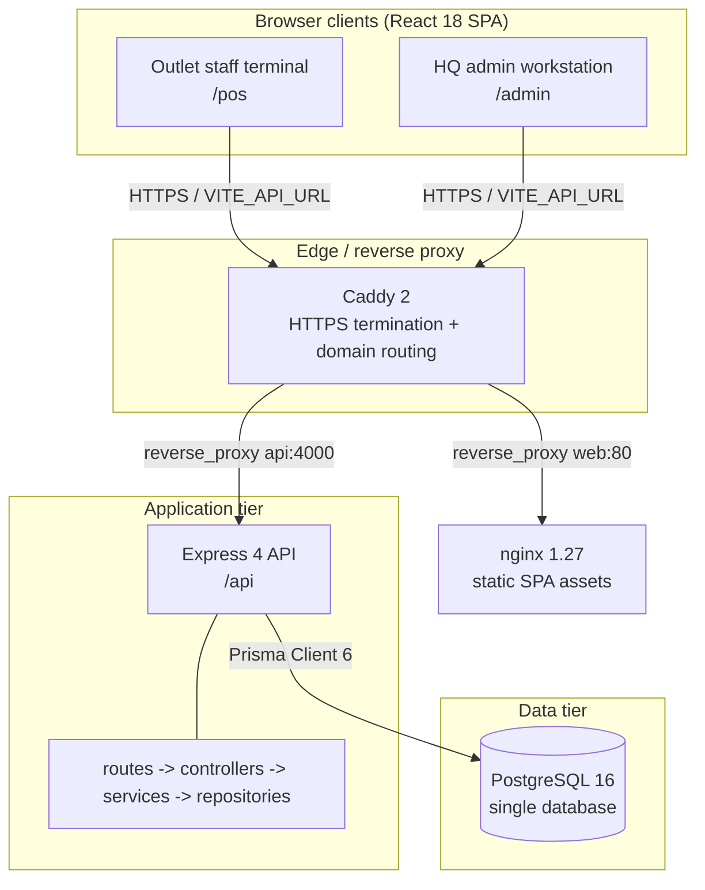
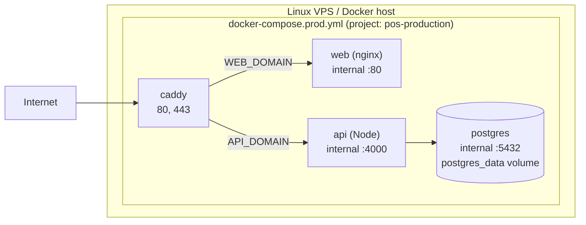
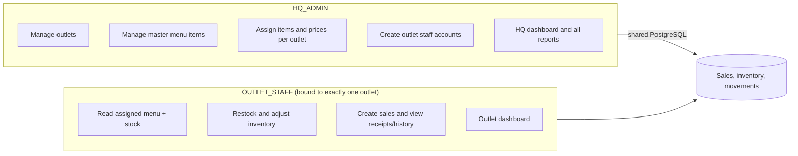
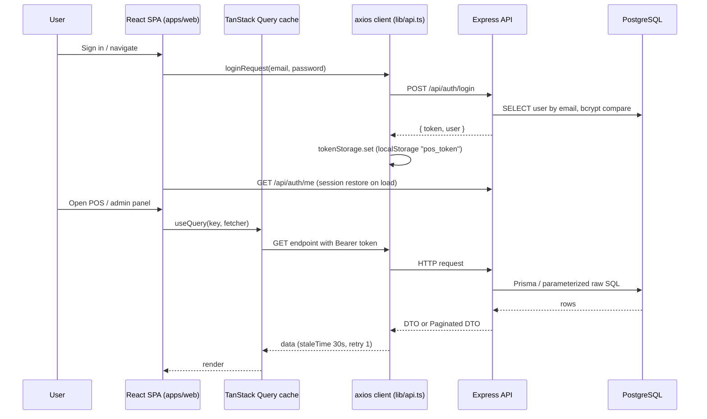
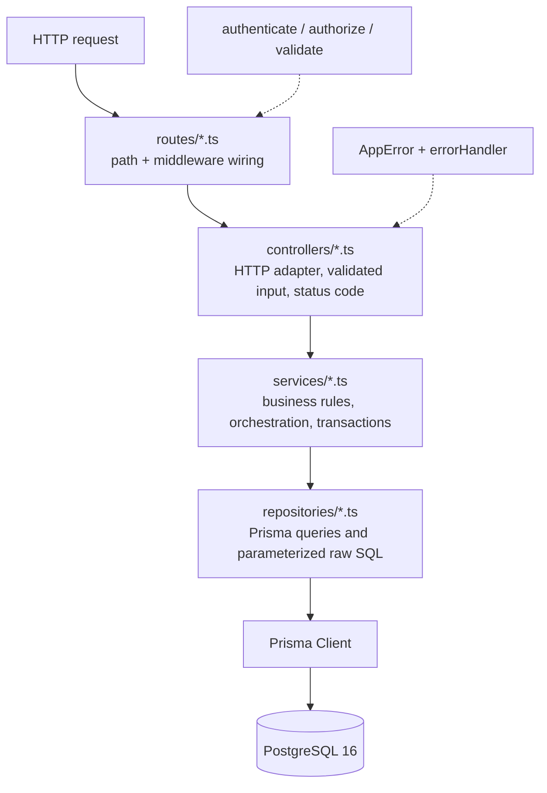
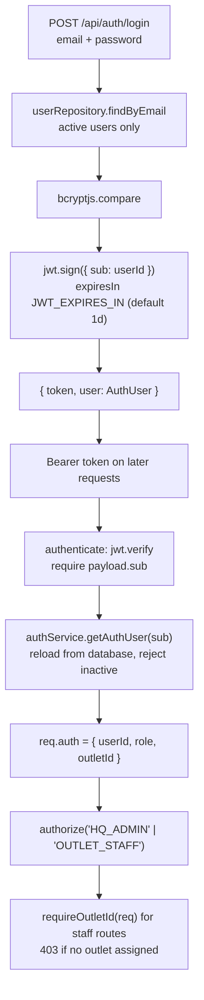
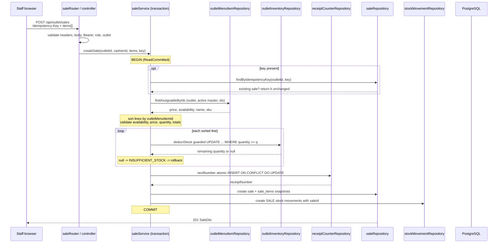
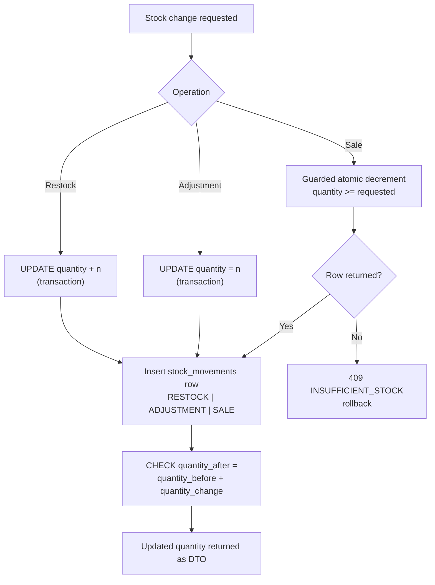
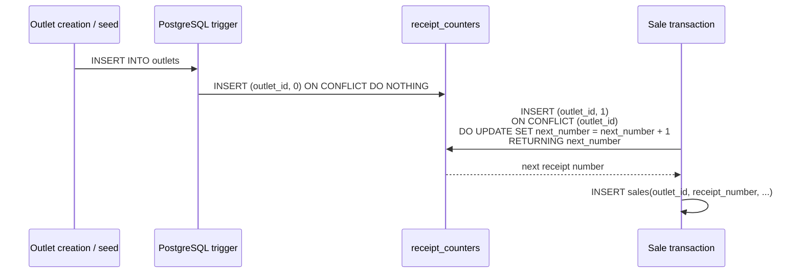
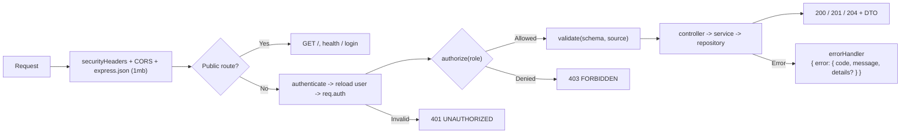

# Architecture

**Status:** the first part of this document describes the implemented modular monolith. Section 12 lists deliberate non-goals and current limitations. Proposed evolution is documented separately in [scaling-strategy.md](scaling-strategy.md), [microservices-migration.md](microservices-migration.md) and [offline-pos-kds-strategy.md](offline-pos-kds-strategy.md).

## 1. Overall system architecture

The system is a **server-authoritative, multi-tenant-by-outlet web application**. A single Express API owns all business rules and all persistent state in one PostgreSQL database. Two browser clients share the API: an outlet POS workspace and an HQ administration workspace. There is no peer-to-peer communication between terminals and no local server in an outlet: every sale, stock change and report request goes to the central API.



In local development, Vite serves the SPA on port `5173` and Caddy is not used; the browser calls the API directly at `VITE_API_URL` (default `http://localhost:4000/api`) with CORS restricted to `CORS_ORIGIN` (default `http://localhost:5173`).

### Deployment topology (implemented)



- Only Caddy publishes host ports; PostgreSQL, API and web are internal-only in production.
- `scripts/deploy.sh` validates required variables, builds images, starts PostgreSQL, applies `prisma migrate deploy`, starts the remaining services and polls the public health endpoint and frontend up to 30 times (10-second intervals).
- Caddy provides automatic TLS using `ACME_EMAIL`. `deploy/Caddyfile` sets response headers and proxies `WEB_DOMAIN → web:80` and `API_DOMAIN → api:4000`.
- The development compose file additionally publishes PostgreSQL (`POSTGRES_PORT`, default 5432), API (`API_PORT`, default 4000) and web (`WEB_PORT`, compose default 8080; `.env.example` uses 4173).
- Container health checks exist for all three services: `pg_isready`, a Node `fetch` of `/api/health`, and an nginx `wget` of `/health`. The production API container additionally has bounded `json-file` logging (10 MB × 5 files per service).
- Node 22 Alpine is used for build stages; `postgres:16-alpine`, `nginx:1.27-alpine` and `caddy:2-alpine` are the runtime images.

## 2. HQ and outlet responsibilities



| Concern | HQ_ADMIN | OUTLET_STAFF |
| --- | --- | --- |
| Outlets | List, create, update, deactivate | None; outlet identity comes from the account |
| Master menu | List, create, update, deactivate | None |
| Outlet menu assignments | Assign items, set outlet price, set availability, deactivate assignment | Read-only list of available, active items |
| Inventory | Indirect visibility through low-stock report | List stock, restock, direct adjustment, movement history |
| Sales | Read via reports and latest-sales dashboard tiles | Create sales, list sales, fetch receipts |
| Dashboards | `/api/dashboard/hq` (all outlets, today) | `/api/dashboard/outlet` (own outlet, today) |

The `users_role_outlet_check` database constraint enforces the identity model: an `HQ_ADMIN` must have `outlet_id IS NULL`, and an `OUTLET_STAFF` row must reference an outlet. Deactivation (`isActive = false`) is used instead of physical deletion for outlets, master menu items and assignments, preserving historical sales.

## 3. Frontend architecture and communication



Implementation details:

- `apps/web/src/main.tsx` composes `QueryClientProvider → AuthProvider → App`. Query defaults: `retry: 1`, `staleTime: 30_000` ms, `refetchOnWindowFocus: false`. Only React Context (auth) and local component state are used; no Redux-like global store and no persisted query cache.
- `apps/web/src/lib/api.ts` defines one axios instance with `baseURL = VITE_API_URL ?? http://localhost:4000/api`, a request interceptor that adds `Authorization: Bearer <token>`, and a response interceptor that clears the stored token and navigates to `/login` on HTTP 401 (except for the login request itself).
- `packages/shared` is a workspace package that exports Zod request schemas and TypeScript DTO types, imported by both the API (runtime validation) and the web app (types). This is the contract boundary between frontend and backend.
- The API validates `body`, `query`, `params` or `headers` with `validate(schema, source)`, which stores the parsed result in `res.locals.validated`. Strict schemas reject unknown fields; pagination defaults to `page=1`, `limit=20` (max 100).
- All list endpoints return `{ items, total, page, limit, totalPages }`; all dates are ISO strings produced with `toISOString()`.
- `GET /api/health` verifies database connectivity with `SELECT 1` and returns `503 SERVICE_UNAVAILABLE` if it fails.
- The SPA is built with Vite (embedded `VITE_API_URL` at build time) and served by nginx with an SPA fallback to `index.html`. Static `/assets/` responses use long-lived immutable caching; API responses are globally marked `Cache-Control: no-store`.

## 4. Layered architecture (implemented)



| Layer | Directory | Responsibility |
| --- | --- | --- |
| Configuration | `apps/api/src/config` | Zod-validated environment, singleton PrismaClient |
| Routes | `apps/api/src/routes` | Mount paths, authentication/authorization guards, validation middleware |
| Controllers | `apps/api/src/controllers` | Extract validated input and identity, choose status code, return DTOs |
| Services | `apps/api/src/services` | Authorization-aware business rules; transaction boundaries; reporting orchestration |
| Repositories | `apps/api/src/repositories` | All database access; outlet-scoped `where` clauses; atomic raw SQL |
| Mappers | `apps/api/src/mappers` | Persistence records → API DTOs |
| Errors / middleware | `apps/api/src/errors`, `middlewares` | Typed errors, async wrapping, security headers, 404 and error normalization |

A notable consequence of this layering is that all database writes for a sale live behind repository functions that accept a `DbClient`, which may be either `PrismaClient` or a `Prisma.TransactionClient`. This allows the service to compose them into one transaction while keeping SQL in the repository layer.

## 5. Authentication and authorization



Critical decisions:

- The JWT contains **only** `sub` (the user ID); role and outlet are not trusted from the token. The user is reloaded from the database on **every** authenticated request, so deactivation or outlet reassignment takes effect immediately.
- The staff outlet is always taken from `req.auth.outletId` (`utils/authContext.ts:requireOutletId`), never from a request parameter or body. Every staff repository query is filtered by that value.
- Staff creation forces `role = OUTLET_STAFF`, hashes the password with bcrypt cost factor 12, and requires 12–200 character passwords (`createStaffUserBodySchema`).
- HQ routers call `authorize('HQ_ADMIN')` at router level; staff routers call `authorize('OUTLET_STAFF')`. There is no public user-listing endpoint.
- Security middleware disables `x-powered-by` and sets `Cache-Control: no-store`, `Referrer-Policy: no-referrer`, `X-Content-Type-Options: nosniff` and `X-Frame-Options: DENY`. CORS allows exactly `CORS_ORIGIN`.
- There is no refresh token, logout endpoint, server-side token revocation or rate limiting. Client-side logout only removes the token from `localStorage`.

## 6. Sales transaction lifecycle

`POST /api/outlet/sales` is the only path that creates sales. The entire operation runs in one Prisma interactive transaction with `ReadCommitted` isolation (`apps/api/src/services/sale.service.ts:73–187`).



### Validation and invariants

Before any write, the service enforces: 1–50 items, no duplicate `outletMenuItemId`, each quantity an integer in `1..1000`, every item assigned to the authenticated outlet and its master item active, each assignment available with an integer price in `1..2,147,483,647`, and both line totals and the sale total within the 32-bit integer range. The equivalent database CHECK constraints provide a second line of defence.

### Atomic stock deduction

`outletInventoryRepository.deductStock` issues a single guarded update (no read-then-write race):

```sql
UPDATE "outlet_inventory" AS oi
SET "quantity" = oi."quantity" - $q, "updated_at" = NOW()
FROM "outlet_menu_items" AS omi
WHERE oi."outlet_menu_item_id" = omi."id"
  AND omi."outlet_id" = $outletId::uuid
  AND oi."outlet_menu_item_id" = $itemId::uuid
  AND oi."quantity" >= $q
RETURNING oi."id", oi."quantity";
```

If no row is returned, the item is out of stock and an `InsufficientStockError` (409) aborts the transaction, rolling back all earlier deductions. Line items are sorted by `outletMenuItemId` before deduction so concurrent multi-item checkouts acquire row locks in a consistent order, reducing deadlock risk.

### Rollback and concurrency test coverage

Tests in `apps/api/tests/sale.transaction.test.ts` verify that a failed sale insert leaves stock, the receipt counter, sales and movements unchanged; that two concurrent sales against one unit of stock yield exactly one success; that concurrent receipt allocation yields unique sequential numbers; that repeated idempotency keys return the original sale without a second deduction; that a P2002 race returns the committed sale; and that the same key at different outlets produces two independent sales.

### Idempotency

- The web client always generates a fresh `crypto.randomUUID()` per checkout and sends it in the `Idempotency-Key` header. On a failed request the key is retained, so a retry is deduplicated; after success the key is reset.
- The API treats the header as optional (1–100 characters, `^[A-Za-z0-9._:-]+$`). Uniqueness is scoped per `(outlet_id, idempotency_key)` by a unique index; PostgreSQL permits multiple `NULL` keys, so non-keyed sales are unaffected.
- Within the transaction the service returns an existing sale for the same key. If two requests race, the loser hits the unique index, and the catch block re-reads and returns the committed sale instead of reporting an error.

## 7. Inventory deduction and movement recording



Every stock change writes a movement with `quantity_before`, signed `quantity_change`, `quantity_after`, actor user (nullable), sale ID (nullable for manual changes), note (restock only) and timestamp. The database CHECK constraint `quantity_after = quantity_before + quantity_change` makes inconsistent audit rows impossible. Sale movements are inserted inside the sale transaction with the new sale ID; a `StockMovement` references `sales` with `ON DELETE SET NULL`, so a movement survives its sale record, while `sale_items` are cascade-deleted with their sale.

## 8. Receipt number generation

Receipt numbers are **per outlet**, sequential and allocated inside the sale transaction by a single atomic upsert.



```sql
INSERT INTO "receipt_counters" ("outlet_id", "next_number")
VALUES ($outletId::uuid, 1)
ON CONFLICT ("outlet_id")
DO UPDATE SET "next_number" = "receipt_counters"."next_number" + 1
RETURNING "next_number" AS "receiptNumber";
```

- The `outlets_create_receipt_counter` trigger creates a row with `next_number = 0` for every new outlet; the upsert also handles a missing counter row defensively.
- The unique index on `(outlet_id, receipt_number)` plus `receipt_number > 0` CHECK guarantees exactly one positive receipt number sequence per outlet, even with concurrent checkouts. Because the counter update and sale insert share a transaction, a rolled-back sale does not consume a number.
- The seed sets each outlet's counter to at least its highest seeded receipt (`MAIN = 5`, `NORTH = 4`), so the next live sale receives 6 and 5 respectively.
- Receipts are assembled on demand from persisted sale snapshots: `GET /api/outlet/sales/:saleId/receipt` returns `SaleDto` plus `receiptTitle: "Receipt #<n>"`. The web client prints it with `window.print()`; it does not generate receipts locally.

## 9. Reporting path

All HQ reports are `GET` endpoints that build parameterized SQL in `reporting.repository.ts` and map rows in `reporting.service.ts`. Report ranges are normalized to UTC day boundaries before aggregation. Revenue always comes from `sales.total_cents`; top items come from `sale_items.quantity` and `sale_items.line_total_cents` snapshots — never from current menu prices. `top-items` ranks the top five items **per outlet** using `ROW_NUMBER() OVER (PARTITION BY outletId ...)`. Every report query executes per request; there is no materialized view, background job or cache (see [scaling-strategy.md](scaling-strategy.md)).

## 10. Request lifecycle summary



## 11. Quality gates

- `npm run verify` runs lint, all three workspace builds, TypeScript checks (including API tests) and `node --test` for the API.
- CI runs on Node 22 with `npm ci` and `npm run verify` for pushes and pull requests.
- Notable test suites cover outlet isolation, authorization, sale transactions and idempotency, inventory operations, reporting accuracy against deterministic seed data, and security headers.

## 12. Current limitations / non-goals

These are facts about the implementation, not oversights in this document:

| Area | Current state |
| --- | --- |
| Offline operation | None. No IndexedDB, SQLite, service worker or pending-transaction queue. |
| KDS | None. No kitchen display, WebSocket, SSE or local gateway code. |
| Messaging / background jobs | None. No RabbitMQ, Kafka or worker process. |
| Caching / materialized reports | None; all reports are live SQL. API responses are `no-store`. |
| Rate limiting / advanced headers | No rate limiter, CSP or HSTS. |
| Tokens | No refresh, revocation or server-side logout endpoint. |
| Sales state machine | No `status`, cancel or void column; a persisted sale is final. |
| Multi-service deployment | One API container and one database; no service decomposition. |

Proposed designs for these areas are explicitly separated in [offline-pos-kds-strategy.md](offline-pos-kds-strategy.md), [microservices-migration.md](microservices-migration.md) and [scaling-strategy.md](scaling-strategy.md).
