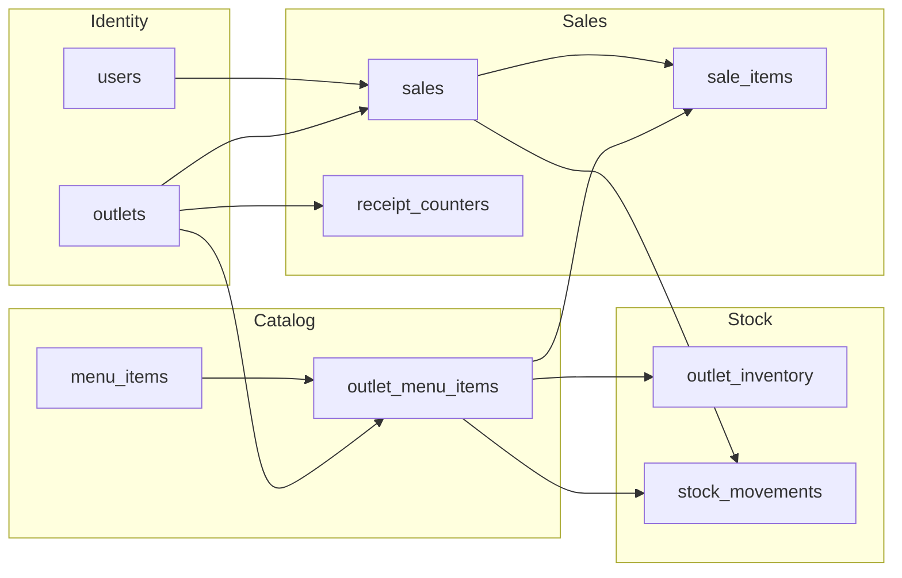
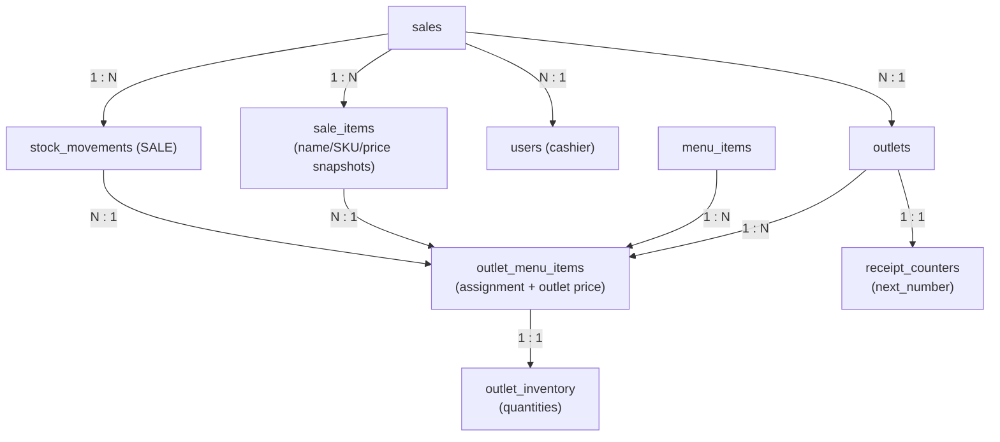

# Database Design

**Status:** implemented schema. Source of truth: `apps/api/prisma/schema.prisma` and the four SQL migration files under `apps/api/prisma/migrations/`. Table and column names below use the physical PostgreSQL names (the Prisma `@map("snake_case")` names), while Prisma model/property names are mentioned where useful.

## 1. Schema overview

The database has **9 tables**, **2 PostgreSQL enum types**, **13 CHECK constraints on business columns plus one role/outlet CHECK**, **13 foreign keys** (9 in the initial migration and 4 on `stock_movements`), and a trigger that provisions a receipt counter for each new outlet.

| Area | Tables |
| --- | --- |
| Identity and organization | `users`, `outlets` |
| Catalog | `menu_items`, `outlet_menu_items` |
| Stock | `outlet_inventory`, `stock_movements` |
| Sales | `sales`, `sale_items`, `receipt_counters` |

### Global conventions

- Primary keys are `UUID` (Prisma `@default(uuid())`); `receipt_counters` uses `outlet_id` itself as its primary key.
- All money columns are `INTEGER` cents; all quantities and counters are `INTEGER`.
- `created_at` / `updated_at` are `TIMESTAMPTZ(6)`; `updated_at` is maintained by Prisma `@updatedAt` except in raw SQL stock updates, which set it to `NOW()`.
- Enums are native PostgreSQL types: `Role ('HQ_ADMIN','OUTLET_STAFF')` and `StockMovementType ('RESTOCK','ADJUSTMENT','SALE')`.
- Deactivation is expressed with `is_active` / `is_available` booleans (no physical deletes from application endpoints).
- Foreign keys use `ON UPDATE CASCADE`. `ON DELETE` behavior is chosen per relation: `CASCADE` for owned child rows (inventory, sale items, assignments), `RESTRICT` for historical references (sales, cashiers, master menu items), `SET NULL` for optional audit attribution (movement actor/sale).

## 2. Table reference

### 2.1 `users`

| Column | Type | Null | Default | Notes |
| --- | --- | --- | --- | --- |
| `id` | UUID | no | generated | **PK** `users_pkey` |
| `email` | VARCHAR(255) | no | — | **UNIQUE** `users_email_key`; login identifier |
| `password_hash` | VARCHAR(255) | no | — | bcrypt hash (cost 12 in seed and staff creation) |
| `full_name` | VARCHAR(150) | no | — | Display name on receipts and DTOs |
| `role` | `Role` | no | — | `HQ_ADMIN` or `OUTLET_STAFF` |
| `outlet_id` | UUID | yes | — | **FK** → `outlets.id`, `ON DELETE RESTRICT` |
| `is_active` | BOOLEAN | no | `true` | Inactive users cannot authenticate |
| `created_at` / `updated_at` | TIMESTAMPTZ(6) | no | `CURRENT_TIMESTAMP` / Prisma | Audit timestamps |

- **Indexes:** `users_outlet_id_idx (outlet_id)`, `users_role_is_active_idx (role, is_active)`.
- **CHECK** `users_role_outlet_check`: `(role='HQ_ADMIN' AND outlet_id IS NULL) OR (role='OUTLET_STAFF' AND outlet_id IS NOT NULL)`.
- Relations: sales as cashier, stock movements as actor.

### 2.2 `outlets`

| Column | Type | Null | Default | Notes |
| --- | --- | --- | --- | --- |
| `id` | UUID | no | generated | **PK** `outlets_pkey` |
| `code` | VARCHAR(50) | no | — | **UNIQUE** `outlets_code_key`; validated `^[A-Za-z0-9_-]+$`, 2–50 chars |
| `name` | VARCHAR(150) | no | — | Display name |
| `address` | VARCHAR(255) | yes | — | Optional |
| `is_active` | BOOLEAN | no | `true` | Deactivation flag |
| `created_at` / `updated_at` | TIMESTAMPTZ(6) | no | `CURRENT_TIMESTAMP` / Prisma | Audit timestamps |

- **Index:** `outlets_is_active_idx (is_active)`.
- **Trigger:** `outlets_create_receipt_counter` inserts a `receipt_counters` row after every outlet insert.
- Owns users, menu assignments, sales, stock movements and its receipt counter.

### 2.3 `menu_items` (master catalog)

| Column | Type | Null | Default | Notes |
| --- | --- | --- | --- | --- |
| `id` | UUID | no | generated | **PK** `menu_items_pkey` |
| `sku` | VARCHAR(50) | no | — | **UNIQUE** `menu_items_sku_key`; validated `^[A-Za-z0-9_-]+$`, 2–50 chars |
| `name` | VARCHAR(150) | no | — | Product name, snapshotted at sale time |
| `category` | VARCHAR(100) | no | — | Filtering/grouping field |
| `description` | TEXT | yes | — | Optional |
| `is_active` | BOOLEAN | no | `true` | Checkout rejects sales of inactive master items |
| `created_at` / `updated_at` | TIMESTAMPTZ(6) | no | `CURRENT_TIMESTAMP` / Prisma | Audit timestamps |

- **Indexes:** `menu_items_is_active_category_idx (is_active, category)`, `menu_items_name_idx (name)`.
- There is intentionally **no price column**; price is per-outlet in `outlet_menu_items.price_cents`.

### 2.4 `outlet_menu_items` (assignment + outlet price)

| Column | Type | Null | Default | Notes |
| --- | --- | --- | --- | --- |
| `id` | UUID | no | generated | **PK** `outlet_menu_items_pkey` |
| `outlet_id` | UUID | no | — | **FK** → `outlets.id` `ON DELETE CASCADE` |
| `menu_item_id` | UUID | no | — | **FK** → `menu_items.id` `ON DELETE RESTRICT` |
| `price_cents` | INTEGER | no | — | Outlet-specific selling price; CHECK `> 0` |
| `is_available` | BOOLEAN | no | `true` | Availability flag checked at checkout |
| `created_at` / `updated_at` | TIMESTAMPTZ(6) | no | `CURRENT_TIMESTAMP` / Prisma | Audit timestamps |

- **UNIQUE** `(outlet_id, menu_item_id)` prevents duplicate assignments.
- **Indexes:** `outlet_menu_items_outlet_id_is_available_idx (outlet_id, is_available)`, `outlet_menu_items_menu_item_id_idx (menu_item_id)`.
- Each assignment owns exactly one inventory row and may be referenced by many sale items and stock movements.
- Deactivating an assignment sets `is_available = false`; it does not delete the row, preserving sale history.

### 2.5 `outlet_inventory`

| Column | Type | Null | Default | Notes |
| --- | --- | --- | --- | --- |
| `id` | UUID | no | generated | **PK** `outlet_inventory_pkey` |
| `outlet_menu_item_id` | UUID | no | — | **FK** → `outlet_menu_items.id` `ON DELETE CASCADE`; **UNIQUE** (1:1) |
| `quantity` | INTEGER | no | `0` | CHECK `>= 0` |
| `low_stock_threshold` | INTEGER | no | `0` | CHECK `>= 0`; used by low-stock report |
| `updated_at` | TIMESTAMPTZ(6) | no | Prisma / `NOW()` | Last stock change |

- **Unique index:** `outlet_inventory_outlet_menu_item_id_key`.
- **Index:** `outlet_inventory_quantity_idx (quantity)`.
- Creating an assignment creates this row with `quantity = 0` and `low_stock_threshold = 0`; the seed uses 100 / 5.

### 2.6 `stock_movements` (audit ledger)

| Column | Type | Null | Default | Notes |
| --- | --- | --- | --- | --- |
| `id` | UUID | no | generated | **PK** `stock_movements_pkey` |
| `outlet_menu_item_id` | UUID | no | — | **FK** → `outlet_menu_items.id` `ON DELETE CASCADE` |
| `outlet_id` | UUID | no | — | **FK** → `outlets.id` `ON DELETE RESTRICT` (denormalized for scoped queries) |
| `movement_type` | `StockMovementType` | no | — | `RESTOCK`, `ADJUSTMENT` or `SALE` |
| `quantity_before` | INTEGER | no | — | CHECK `>= 0` |
| `quantity_change` | INTEGER | no | — | CHECK `<> 0` (negative only for sales) |
| `quantity_after` | INTEGER | no | — | CHECK `>= 0` |
| `actor_user_id` | UUID | yes | — | **FK** → `users.id` `ON DELETE SET NULL` |
| `sale_id` | UUID | yes | — | **FK** → `sales.id` `ON DELETE SET NULL`; set for `SALE` movements |
| `note` | VARCHAR(255) | yes | — | Used for restock notes |
| `created_at` | TIMESTAMPTZ(6) | no | `CURRENT_TIMESTAMP` | Movement time |

- **CHECK** `quantity_after = quantity_before + quantity_change` guarantees the ledger is arithmetically consistent.
- **Indexes:** `(outlet_id, created_at)`, `(outlet_menu_item_id, created_at)`, `(sale_id)`.

### 2.7 `sales`

| Column | Type | Null | Default | Notes |
| --- | --- | --- | --- | --- |
| `id` | UUID | no | generated | **PK** `sales_pkey` |
| `outlet_id` | UUID | no | — | **FK** → `outlets.id` `ON DELETE RESTRICT` |
| `cashier_id` | UUID | no | — | **FK** → `users.id` `ON DELETE RESTRICT` |
| `receipt_number` | INTEGER | no | — | CHECK `> 0`; unique per outlet |
| `total_cents` | INTEGER | no | — | CHECK `>= 0`; sum of line totals at sale time |
| `idempotency_key` | VARCHAR(100) | yes | — | Optional retry key; unique per outlet when present |
| `created_at` | TIMESTAMPTZ(6) | no | `CURRENT_TIMESTAMP` | Sale time used by all report ranges |

- **Unique indexes:** `(outlet_id, receipt_number)`, `(outlet_id, idempotency_key)`.
- **Indexes:** `(outlet_id, created_at)`, `(createdAt, outletId)` physical name `sales_created_at_outlet_id_idx`, `(cashier_id)`.
- There is no status, void or soft-delete column: a persisted row is a completed sale.

### 2.8 `sale_items` (sale-time snapshots)

| Column | Type | Null | Default | Notes |
| --- | --- | --- | --- | --- |
| `id` | UUID | no | generated | **PK** `sale_items_pkey` |
| `sale_id` | UUID | no | — | **FK** → `sales.id` `ON DELETE CASCADE` |
| `outlet_menu_item_id` | UUID | no | — | **FK** → `outlet_menu_items.id` `ON DELETE RESTRICT` |
| `menu_item_name` | VARCHAR(150) | no | — | Name snapshot (not a live join) |
| `menu_item_sku` | VARCHAR(50) | no | — | SKU snapshot |
| `quantity` | INTEGER | no | — | CHECK `> 0` |
| `unit_price_cents` | INTEGER | no | — | CHECK `> 0`; price charged, not current price |
| `line_total_cents` | INTEGER | no | — | CHECK `>= 0`; `quantity × unit_price_cents` as written by the service |

- **Indexes:** `(sale_id)`, `(sale_id, menu_item_sku)`, `(outlet_menu_item_id)`, `(menu_item_sku)`.
- Snapshotting name, SKU and price makes receipts and historical reports immune to later catalog or price changes.

### 2.9 `receipt_counters`

| Column | Type | Null | Default | Notes |
| --- | --- | --- | --- | --- |
| `outlet_id` | UUID | no | — | **PK** (also **FK** → `outlets.id` `ON DELETE CASCADE`) |
| `next_number` | INTEGER | no | `0` | CHECK `>= 0`; incremented atomically per sale |

An insert trigger on `outlets` seeds this row with `0`. `receiptCounterRepository.nextNumber` uses one `INSERT … ON CONFLICT DO UPDATE … RETURNING` statement to allocate the next number; no separate read is required.

## 3. Complete index inventory

| Index | Table | Columns | Type | Purpose |
| --- | --- | --- | --- | --- |
| `users_email_key` | users | email | UNIQUE | Login lookup |
| `users_outlet_id_idx` | users | outlet_id | normal | Staff by outlet |
| `users_role_is_active_idx` | users | role, is_active | normal | Active role filters |
| `outlets_code_key` | outlets | code | UNIQUE | Outlet code uniqueness |
| `outlets_is_active_idx` | outlets | is_active | normal | Active outlet lists |
| `menu_items_sku_key` | menu_items | sku | UNIQUE | SKU uniqueness |
| `menu_items_is_active_category_idx` | menu_items | is_active, category | normal | Catalog filtering |
| `menu_items_name_idx` | menu_items | name | normal | Name lookups/sorting |
| `outlet_menu_items_outlet_id_is_available_idx` | outlet_menu_items | outlet_id, is_available | normal | Staff menu list and sale validation |
| `outlet_menu_items_menu_item_id_idx` | outlet_menu_items | menu_item_id | normal | Reverse assignment lookup |
| `outlet_menu_items_outlet_id_menu_item_id_key` | outlet_menu_items | outlet_id, menu_item_id | UNIQUE | One assignment per item/outlet |
| `outlet_inventory_outlet_menu_item_id_key` | outlet_inventory | outlet_menu_item_id | UNIQUE | One inventory row per assignment |
| `outlet_inventory_quantity_idx` | outlet_inventory | quantity | normal | Low-stock queries |
| `sales_outlet_id_created_at_idx` | sales | outlet_id, created_at | normal | Outlet sales history and scoped aggregation |
| `sales_created_at_outlet_id_idx` | sales | created_at, outlet_id | normal | HQ date-range aggregation across outlets |
| `sales_cashier_id_idx` | sales | cashier_id | normal | Cashier lookups |
| `sales_outlet_id_receipt_number_key` | sales | outlet_id, receipt_number | UNIQUE | Receipt uniqueness per outlet |
| `sales_outlet_id_idempotency_key_key` | sales | outlet_id, idempotency_key | UNIQUE | Retry deduplication |
| `sale_items_sale_id_idx` | sale_items | sale_id | normal | Receipt assembly |
| `sale_items_sale_id_menu_item_sku_idx` | sale_items | sale_id, menu_item_sku | normal | Top-item join/ranking |
| `sale_items_outlet_menu_item_id_idx` | sale_items | outlet_menu_item_id | normal | Item history |
| `sale_items_menu_item_sku_idx` | sale_items | menu_item_sku | normal | SKU reporting |
| `stock_movements_outlet_id_created_at_idx` | stock_movements | outlet_id, created_at | normal | Outlet movement history |
| `stock_movements_outlet_menu_item_id_created_at_idx` | stock_movements | outlet_menu_item_id, created_at | normal | Per-item movement history |
| `stock_movements_sale_id_idx` | stock_movements | sale_id | normal | Sale → movements |

All 25 non-primary-key indexes are listed (unique indexes included; the 9 primary-key indexes are implicit). The last two `sales` / `sale_items` indexes were added by the `20261119000000_hq_reporting_indexes` migration.

## 4. Relationships and key flows

A complete visual model is in [erd.md](erd.md). The most important operational relationships are:

1. **Menu assignments.** A master `menu_items` row becomes sellable at an outlet only when an `outlet_menu_items` row joins them. That row carries the outlet price and availability. Assignment creation also creates the `outlet_inventory` row; assignment deletion in the API is availability deactivation, so historical `sale_items` references remain valid.
2. **Sales and items.** Each `sales` row has one or more `sale_items`. Items copy name, SKU, unit price and line total from the assignment at the moment of checkout. Historical revenue therefore never changes when HQ updates a price.
3. **Inventory and movements.** Each sale decrements `outlet_inventory.quantity` and writes a matching `stock_movements` row of type `SALE` linked to the sale. Restocks and manual adjustments write `RESTOCK` / `ADJUSTMENT` rows without a sale ID. The `(quantity_before, quantity_change, quantity_after)` triple is checked by the database.
4. **Receipt counters.** Each outlet has exactly one counter row. The counter is incremented inside the sale transaction, and the unique `(outlet_id, receipt_number)` index makes duplicate receipt numbers impossible. The counter is rolled back with a failed sale.
5. **Idempotency.** `(outlet_id, idempotency_key)` uniquely identifies a client checkout attempt. Retries resolve to the first committed sale, including stock movements and receipt number.

## 5. Concurrency and integrity decisions

| Decision | Mechanism | Rationale |
| --- | --- | --- |
| Prevent overselling | One `UPDATE … WHERE quantity >= q RETURNING` per line; transaction rollback on `null` | Never read-modify-write stock; row locks serialize competing buyers |
| Reduce deadlocks | Sort sale lines by `outletMenuItemId` before deduction | Concurrent carts touching the same items acquire locks in the same order |
| Unique receipt numbers | Atomic counter upsert + unique index | Allocation is atomic and survives concurrent checkouts; no gaps on rollback |
| Duplicate submissions | Unique `(outlet_id, idempotency_key)` + in-transaction lookup + P2002 re-read | Client retries after network failure cannot double-charge stock |
| Non-negative stock | CHECK constraint plus guarded update | Defense in depth against application bugs and direct SQL |
| Audit correctness | CHECK `quantity_after = quantity_before + quantity_change` | Movement rows cannot accidentally misstate stock transitions |
| Money bounds | Service-level 32-bit limits plus CHECK constraints | Avoid integer overflow in PostgreSQL `INTEGER` columns |
| Historical accuracy | Sale-time snapshots and immutable sales | Reports remain correct after catalog/price changes |
| Outlet isolation | `outlet_id` on sales, movements, assignments and users; scoped queries | Prevents a staff member from reading or mutating another outlet's data |

Transaction isolation is explicitly `ReadCommitted` for checkout. The guarded updates provide the needed row-level protection without a stronger, more contention-prone isolation level.

## 6. Migration history

| Migration | Contents |
| --- | --- |
| `20260101000000_init` | Enums, 8 tables, all base indexes/FKs/CHECKs, receipt counter trigger |
| `20260201000000_inventory_movements` | `StockMovementType`, `stock_movements` table, indexes, FKs and CHECKs |
| `20260202000000_sale_idempotency` | `sales.idempotency_key` column and `(outlet_id, idempotency_key)` unique index |
| `20261119000000_hq_reporting_indexes` | `sales(created_at, outlet_id)` and `sale_items(sale_id, menu_item_sku)` indexes |

Migrations are applied with `npm run prisma:migrate` in development and `prisma migrate deploy` (via `docker-compose` command / `scripts/deploy.sh`) in production. No migration creates a view, materialized view or scheduled refresh job.

## 7. Seed data (deterministic)

`npm run prisma:seed` upserts:

- 2 outlets: `MAIN` / "Main Outlet", `NORTH` / "North Outlet".
- 1 HQ admin with `SEED_ADMIN_EMAIL` / `SEED_ADMIN_PASSWORD` / `SEED_ADMIN_NAME`, `outlet_id = NULL`.
- 2 staff accounts, `staff.main@example.com` and `staff.north@example.com`, both using `SEED_STAFF_PASSWORD` (bcrypt cost 12) and bound to their respective outlets.
- 7 master menu items (`COFFEE`, `CROISSANT`, `BURGER`, `TEA`, `MUFFIN`, `JUICE`, `SANDWICH`).
- 14 outlet assignments (7 × 2) with price equal to the master catalog price in `seedTransactions.ts`, stock `100`, threshold `5`.
- 9 completed sales (5 MAIN, 4 NORTH) with fixed timestamps, receipt numbers and sale-time prices that intentionally differ from current prices. Two sales fall outside the canonical reporting window (`2026-01-05`–`2026-01-06`) to test date filtering.
- Receipt counters raised to at least `MAIN = 5`, `NORTH = 4`.

Re-seeding is upsert-based: existing sales are never modified, but user credentials, menu data, prices and inventory values are overwritten. Seed passwords must be supplied through environment variables (minimum 12 characters); none are hardcoded.
