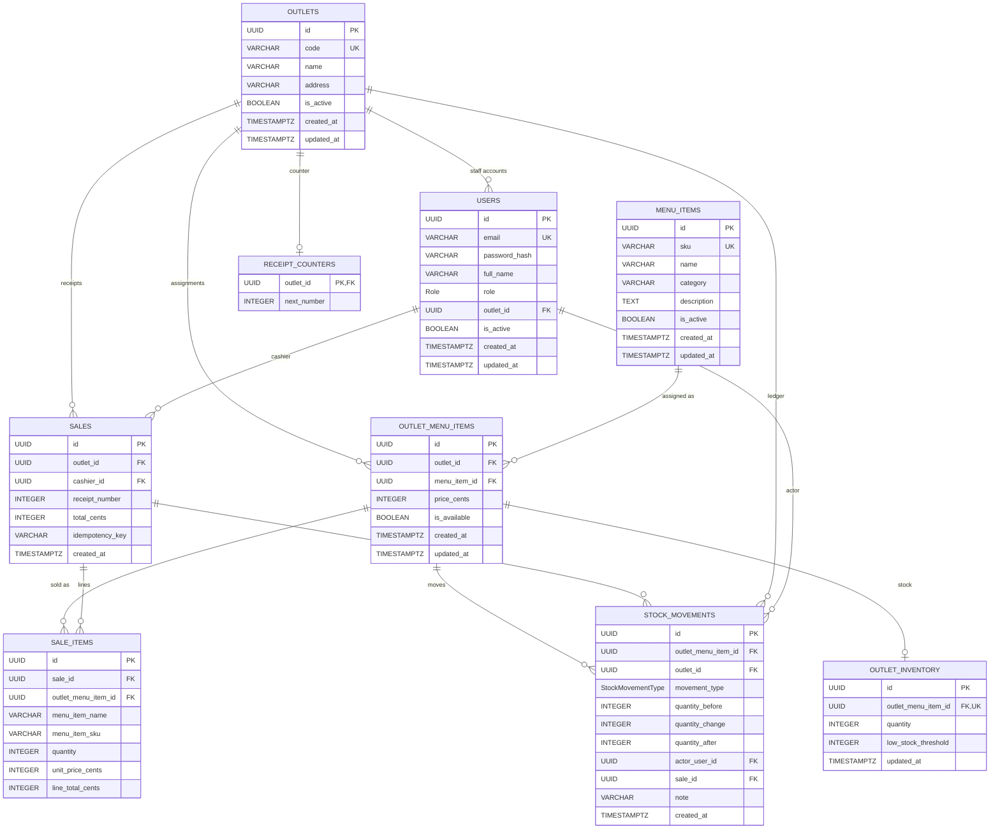
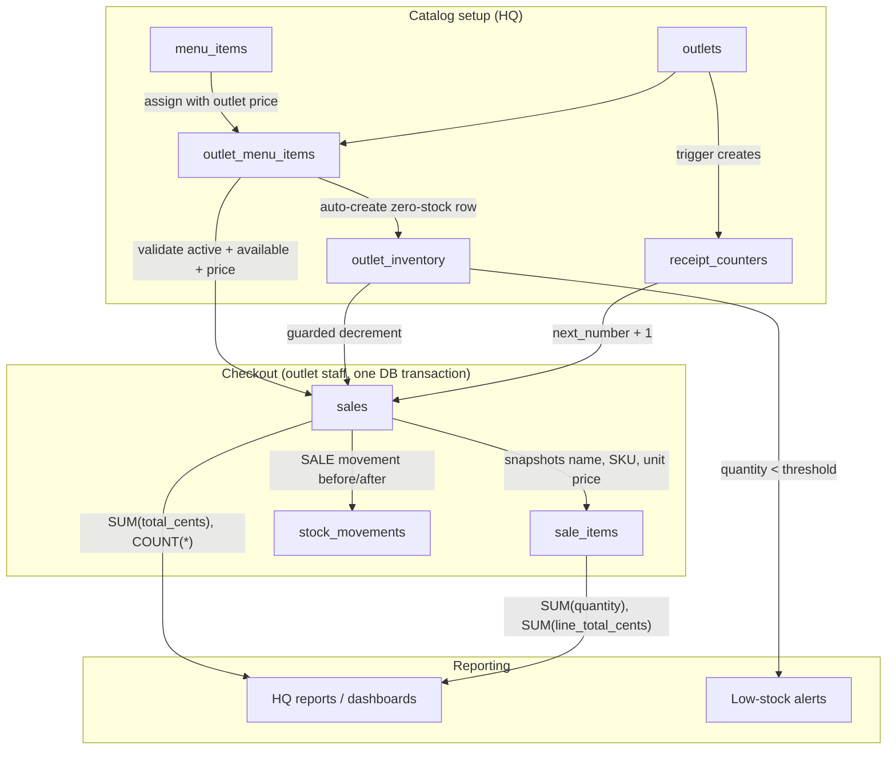

# Entity–Relationship Diagram

**Status:** generated from the implemented Prisma schema (`apps/api/prisma/schema.prisma`) and its migrations. Physical table names are used. For column types, constraints and indexes, see [database-design.md](database-design.md).

## 1. Complete ERD

Comma-separated keys (`FK, UK` and `PK, FK`) denote attributes that play two roles: `outlet_inventory.outlet_menu_item_id` is a unique foreign key, and `receipt_counters.outlet_id` is both primary key and foreign key.

## 2. Relationship register

| Parent → child | Cardinality | Child FK column | `ON DELETE` | Meaning |
| --- | --- | --- | --- | --- |
| `outlets → users` | 1 : 0..N | `users.outlet_id` | RESTRICT | Staff belong to one outlet; HQ admins have `NULL` |
| `outlets → outlet_menu_items` | 1 : 0..N | `outlet_menu_items.outlet_id` | CASCADE | Outlet-specific catalog assignments |
| `menu_items → outlet_menu_items` | 1 : 0..N | `outlet_menu_items.menu_item_id` | RESTRICT | Master product can be assigned to many outlets |
| `outlet_menu_items → outlet_inventory` | 1 : 0..1 | `outlet_inventory.outlet_menu_item_id` | CASCADE | One stock record per assignment |
| `outlet_menu_items → sale_items` | 1 : 0..N | `sale_items.outlet_menu_item_id` | RESTRICT | Historical line references keep assignments intact |
| `outlet_menu_items → stock_movements` | 1 : 0..N | `stock_movements.outlet_menu_item_id` | CASCADE | Per-item audit trail |
| `outlets → sales` | 1 : 0..N | `sales.outlet_id` | RESTRICT | Sales are immutable outlet history |
| `users → sales` | 1 : 0..N | `sales.cashier_id` | RESTRICT | Cashier attribution on receipts |
| `sales → sale_items` | 1 : 1..N | `sale_items.sale_id` | CASCADE | Basket lines belong to one sale |
| `sales → stock_movements` | 1 : 0..N | `stock_movements.sale_id` | SET NULL | Sale-linked stock movements; survive manual sale deletion |
| `outlets → stock_movements` | 1 : 0..N | `stock_movements.outlet_id` | RESTRICT | Denormalized for outlet-scoped movement queries |
| `users → stock_movements` | 1 : 0..N | `stock_movements.actor_user_id` | SET NULL | Optional actor attribution |
| `outlets → receipt_counters` | 1 : 0..1 | `receipt_counters.outlet_id` | CASCADE | Per-outlet number sequence |

All foreign keys use `ON UPDATE CASCADE`. `UNIQUE` constraints exist on `users.email`, `outlets.code`, `menu_items.sku`, `(outlet_id, menu_item_id)`, `outlet_inventory.outlet_menu_item_id`, `(outlet_id, receipt_number)` and `(outlet_id, idempotency_key)`.

## 3. Key data flows expressed as relationships

### How the five core concepts relate

1. **Sales ↔ sale items.** A sale has at least one line item. Each line stores the outlet assignment ID for traceability, but copies `menu_item_name`, `menu_item_sku`, `unit_price_cents` and `line_total_cents` at checkout. Reports and receipts read these snapshots, not live catalog rows.
2. **Sales ↔ menu assignments.** An item can only be sold if an `outlet_menu_items` row exists for the authenticated outlet, the master `menu_items.is_active` is true and the assignment's `is_available` is true. The assignment's `price_cents` is the source for the line snapshot.
3. **Sales ↔ outlet inventory.** Stock is held per assignment, not per master item or per SKU globally. Checkout decrements each affected inventory row with a conditional update; insufficient stock aborts the entire sale.
4. **Sales ↔ receipt counters.** Each outlet has one counter row. The checkout transaction allocates the next number from it and stores the value in `sales.receipt_number`; the unique `(outlet_id, receipt_number)` index is the final guard.
5. **Sales ↔ stock movements.** Every successful sale writes one movement per line item with `movement_type = 'SALE'`, a negative `quantity_change`, the sale ID and the cashier as actor. Manual restocks/adjustments produce movements with a `NULL` sale ID.

## 4. Notes on diagram conventions

- Mermaid `o|` means zero or one; `||` means exactly one; `o{` / `|{` mean zero/many or one/many. For example, `SALES ||--o{ SALE_ITEMS` reads "one sale has zero or more sale items" — application validation requires at least one, but the database has no such constraint.
- The ERD intentionally shows no status column on `sales`, no price on `menu_items`, and no merchant/tenant table: those features do not exist in the current schema.
- Enum attributes (`Role`, `StockMovementType`) are shown as PostgreSQL enum types declared by the initial and inventory-movement migrations respectively.
