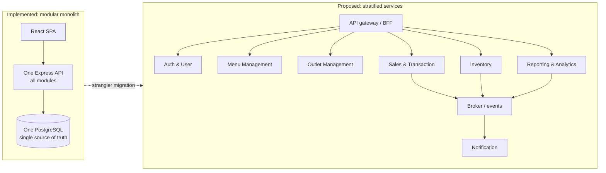
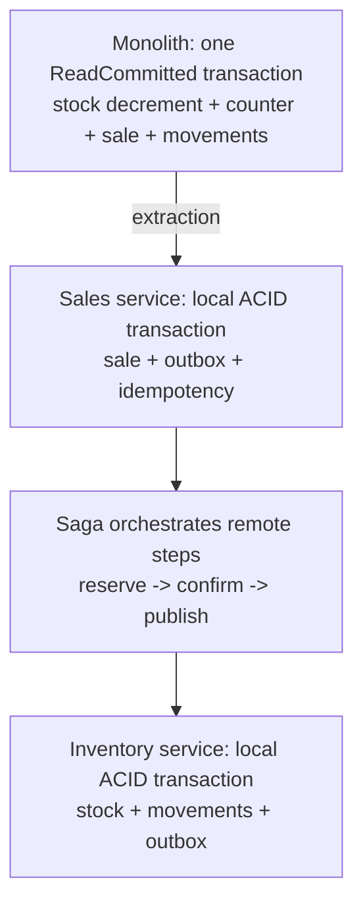
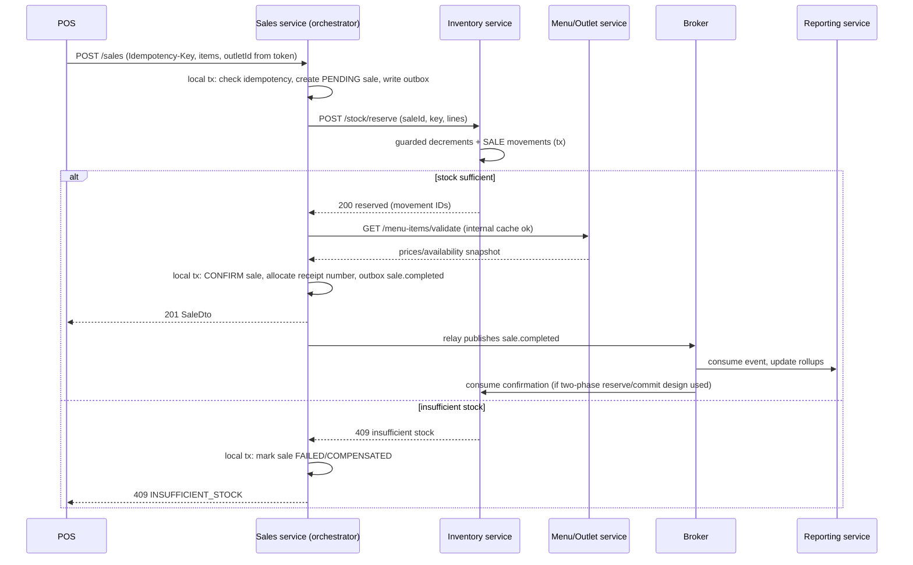
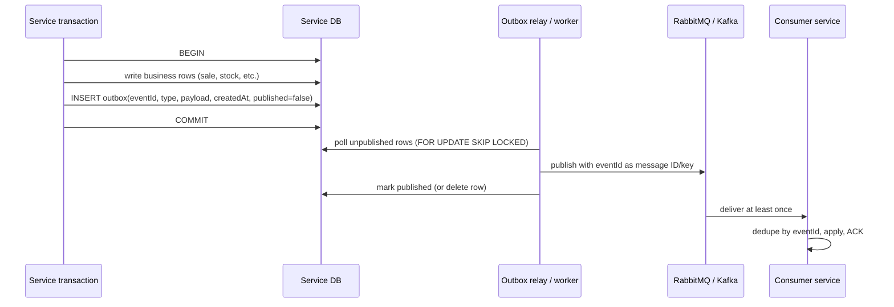
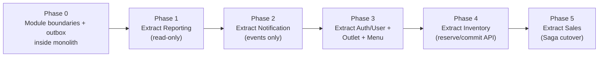

# Microservices Migration Strategy

**Status: proposal only.** The implemented system is a modular monolith (one Express API, one PostgreSQL database) and is appropriate for the target scale of 10 outlets and 100,000 sales per month. Microservices are **not a requirement** for the current implementation and should only be considered when independent team ownership, deployment cadence or isolation needs justify their operational cost.

## 1. Premise and principles

1. **Keep the working monolith as the reference implementation.** Every extracted service must preserve the existing guarantees: per-outlet stock cannot oversell, receipt numbers are unique per outlet, retries cannot double-charge stock, and reports use sale-time snapshots.
2. **Extract along existing module boundaries.** The repository already separates routes/controllers/services/repositories. Business modules are implicitly present: identity, catalog, outlet management, inventory, sales and reporting.
3. **Data ownership follows capability.** A service is the only writer of its tables. Other services query it through APIs or consume events; they never write its tables directly.
4. **Asynchrony is additive.** Introduce workers and events inside the monolith first; then move them out with the data they own.
5. **No distributed transaction on the hot checkout path unless unavoidable.** If it becomes unavoidable, use a Saga with explicit compensations (Section 5).

## 2. Service catalog

| Service | Core responsibility | Owns data | Primary consumers | Deployment trigger |
| --- | --- | --- | --- | --- |
| Auth & User | Credentials, JWT issuance, user lifecycle, role/outlet assignments | `users` (and future sessions/permissions) | All services, SPA | Shared identity policy or security/compliance cadence |
| Menu Management | Master catalog, categories, availability, SKU validation | `menu_items` | POS, Sales, Reporting | Frequent catalog change ownership by a separate team |
| Outlet Management | Outlet registry, codes, activation, staff-outlet mapping view | `outlets` | All services, HQ UI | Outlet onboarding autonomy |
| Inventory | Per-outlet stock, thresholds, movement ledger, stock adjustments | `outlet_inventory`, `stock_movements` | POS, Sales, Reporting | High stock-write contention or independent warehouse integration |
| Sales & Transaction | Checkout, idempotency, receipt numbers, sale and line snapshots | `sales`, `sale_items`, `receipt_counters` | POS, Reporting, Notification | Highest-value isolation target; extract last |
| Reporting & Analytics | Dashboards, daily/monthly rollups, exports, top items, low stock | Read models / rollups (owned copies) | HQ UI, external BI | Read load or schema evolution independent of writes |
| Notification | Receipts/email/SMS/webhooks, delivery retries | Notification log and templates | Sales, Inventory, Reporting | Any outbound side effect with retry requirements |

### 2.1 Authentication and User Service

- **Responsibilities:** login (`bcryptjs` verification), JWT signing/validation policy, `GET /me`, staff provisioning, activation/deactivation, exposing a trusted `AuthUser` to other services.
- **Why separate:** identity is a cross-cutting concern with distinct security requirements; centralizing it avoids duplicating password/JWT logic and allows independent security releases.
- **Data ownership:** the `users` table and credentials. The `users_role_outlet_check` rule (HQ admin has no outlet; staff has one) remains enforced here.
- **API communication:** gateway validates tokens or delegates introspection; internal services call `GET /users/:id` / `GET /me` to obtain current role and outlet. The existing design already reloads the user per request — this translates naturally into a cached internal lookup with short TTL.
- **Events:** `user.created`, `user.deactivated`, `user.outlet_changed`. Inventory and Sales may consume these to update local actor/outlet caches.
- **Deployment independence:** own database/schema, own release cycle; a token-key rotation does not require redeploying POS or reporting.

### 2.2 Menu Management Service

- **Responsibilities:** master item CRUD, SKU uniqueness, category/name/description, activation; publishes price-neutral catalog facts. Outlet-specific prices remain with the assignment concept.
- **Why separated:** catalog changes are frequent and mostly read-heavy; caching and CDN-style distribution can evolve independently of transactional sales.
- **Data ownership:** `menu_items` and category metadata. **Not** `outlet_menu_items.price_cents` if pricing is treated as a commercial decision of Outlet Management; either way, one service must be the authority and the other must reference it by ID.
- **API:** `GET /menu-items`, `GET /menu-items/:id` (internal), HQ write endpoints. Sales snapshots name/SKU at checkout, so historical receipts do not require synchronous catalog lookups.
- **Events:** `menuItem.created`, `menuItem.updated`, `menuItem.deactivated`. Sales/inventory read models cache these for validation; POS terminals refresh their local menu cache from these events/API versions.
- **Deployment independence:** catalog releases can ship without redeploying checkout.

### 2.3 Outlet Management Service

- **Responsibilities:** outlet registry (`code`, `name`, `address`, activation), outlet lifecycle, outlet-level configuration and the assignment of menu items/prices if pricing is centralized.
- **Why separated:** outlet onboarding is an administrative workflow with its own approvals; it also provides the canonical outlet list needed by Auth, Inventory, Sales and Reporting.
- **Data ownership:** `outlets` and (if assigned here) `outlet_menu_items` assignment/price data.
- **API:** `GET /outlets/:id`, `GET /outlets/:id/menu-items`, HQ writes. Services validate that an outlet is active before accepting operations.
- **Events:** `outlet.created` (must trigger creation of a receipt counter and stock rows), `outlet.deactivated`, `outletMenu.priceChanged`, `outletMenu.unassigned`.
- **Deployment independence:** new outlet types or configuration fields do not affect checkout binaries.

### 2.4 Inventory Service

- **Responsibilities:** per-outlet stock, low-stock thresholds, guarded decrements, restocks/adjustments and the immutable movement ledger.
- **Why separated:** stock is the most contended resource and the natural integration point for warehouse/supplier systems. It also has a very different access pattern (many small atomic writes plus audit reads) from sales or reporting.
- **Data ownership:** `outlet_inventory`, `stock_movements`, plus a locally cached copy of outlet/menu IDs needed for validation.
- **API:** `POST /stock/reserve` (idempotency key + sale ID + lines), `POST /stock/commit`, `POST /stock/release`, `GET /stock?outletId=...`, `GET /movements?outletId=...`. The SQL primitives from the monolith (`UPDATE … WHERE quantity >= q RETURNING`, movement CHECK) move unchanged into this service.
- **Events:** `stock.reserved`, `stock.released`, `stock.low`, `stock.adjusted`. Reporting consumes these for low-stock dashboards; Notification consumes `stock.low`.
- **Deployment independence:** inventory scaling, locking strategy and supplier integrations evolve independently.

### 2.5 Sales and Transaction Service

- **Responsibilities:** cart validation, checkout orchestration, receipt numbering, sale and sale-item snapshots, receipts/history queries, idempotency enforcement.
- **Why separated:** checkout is the business-critical path; isolating it permits independent scaling, stricter change control and a dedicated on-call surface. It is also the natural owner of the customer-visible transaction.
- **Data ownership:** `sales`, `sale_items`, `receipt_counters`, and the transactional outbox (Section 6). Receipt numbers remain per outlet and are allocated with the same atomic upsert.
- **API:** `POST /sales` with `Idempotency-Key`, `GET /sales/:id`, `GET /sales/:id/receipt`, `GET /sales?outletId=...`.
- **Events:** `sale.completed` (sale ID, outlet ID, cashier ID, total, line snapshots), `sale.failed`, `sale.compensated`. Reporting, Notification and Inventory consumers use these.
- **Deployment independence:** checkout releases can be canary-deployed; its database can be sized and backed up independently.
- **Important caveat:** after extraction, a checkout cannot atomically update both the Inventory and Sales databases. The monolith's single transaction is replaced by a Saga (Section 5). Keep this service last in the migration order.

### 2.6 Reporting and Analytics Service

- **Responsibilities:** HQ dashboards, all report endpoints, rollup/materialized-view maintenance, exports, data-retention policy for analytical models.
- **Why separated:** read-heavy analytical workloads and the need for schema flexibility are very different from OLTP checkout; it is the safest first extraction because it owns no source-of-truth transactional data.
- **Data ownership:** its own read-model database/tables: daily sales by outlet, top items, low-stock snapshots and dashboard aggregates. It consumes events from Sales, Inventory, Menu and Outlet services.
- **API:** the existing report/dashboard endpoints; optionally a separate read replica or columnar store behind it.
- **Events:** publishes `report.snapshotReady`, `report.exportReady`; consumes `sale.completed`, `stock.adjusted`, `menuItem.updated`, `outlet.deactivated`.
- **Deployment independence:** report schema changes, backfills and heavy queries never block checkout releases.

### 2.7 Notification Service

- **Responsibilities:** render and deliver receipt emails/SMS, low-stock alerts and operational webhooks; retry with backoff; deduplicate by event ID; maintain a delivery log.
- **Why separated:** outbound providers are slow and failure-prone; isolating them keeps provider outages and retry storms away from checkout.
- **Data ownership:** templates, delivery attempts, notification log (no business entity ownership).
- **API:** `POST /notifications` for explicit sends; internal admin endpoints for templates and delivery status.
- **Events:** consumes everything it needs (`sale.completed`, `stock.low`, `report.exportReady`); publishes `notification.delivered`, `notification.failed`.
- **Deployment independence:** provider credentials and queue sizing are managed without touching POS or Sales.

## 3. Synchronous versus event-driven communication

### 3.1 When to use each

| Interaction | Pattern | Reason |
| --- | --- | --- |
| Login, current user, receipt fetch, POS menu read | Synchronous REST/gRPC through gateway | User is waiting; strong read-after-write needed |
| Stock reserve/confirm/release during checkout | Synchronous internal call (short timeout, idempotent) | Participant must acknowledge before the saga advances |
| Analytics updates, low-stock alerts, notifications, exports | Asynchronous events | Side effects can lag; isolates failures |
| Cross-service cache invalidation | Events with version numbers | Avoids polling and tight coupling |

Use an API gateway/BFF to preserve the current `/api/...` contract for the SPA while routing to internal services. Internal calls should use mTLS or a service mesh once the service count grows; pass a request/correlation ID and the authenticated user ID (never trust client-supplied outlet IDs).

### 3.2 RabbitMQ vs Kafka

| Criterion | RabbitMQ | Kafka |
| --- | --- | --- |
| Model | Work queues, routing keys, exchanges | Append-only partitioned event log |
| Best for | Commands and background jobs, per-message ACK/retry, delayed retry queues | High-volume event streaming, replay, multiple independent consumers, stream analytics |
| Ordering | Per queue | Per partition key (for example, `outletId`) |
| Replay | Limited; messages consumed and removed | Native retention and consumer-group replay |
| Operational cost | Lower for a small team | Higher (brokers, ZooKeeper/KRaft, topic governance) |
| Fit here | **Recommended first** for job queues and saga commands | Consider only if event replay/stream processing becomes a real requirement |

**Recommendation:** introduce RabbitMQ first for background jobs and inter-service commands (topic exchanges with per-service queues, dead-letter queues, retry policies). Add Kafka later only if there is a concrete need to replay long event histories or feed stream-processing/analytics pipelines. Use partition/exchange keys such as `outletId` so per-outlet order is preserved.

## 4. Transactional consistency after extraction

Rules:

1. **Preserve local ACID where it exists.** Inside Sales, sale creation, receipt number allocation and outbox insertion commit together. Inside Inventory, stock decrement and movement insertion commit together.
2. **Never use two-phase commit (2PC).** It is blocking, fragile and poorly supported by common web stacks.
3. **Compensate rather than roll back globally.** If a later saga step fails, execute a compensating action (release reservation, mark sale compensated, notify cashier).
4. **Make every step idempotent** using a stable `saleId` / `idempotencyKey` pair.
5. **Accept eventual consistency for read models.** Reports may lag by seconds; the receipt shown immediately after checkout must still come from Sales' own database.

## 5. Saga pattern for checkout

Practical notes:

- The current schema has **no sale status column**. A saga requires adding one (`PENDING`, `CONFIRMED`, `FAILED`, `COMPENSATED`) plus a status history or outbox state machine. That is a schema change that should only happen as part of extraction.
- Alternative choreography: Sales emits `sale.created`, Inventory reserves and emits `stock.reserved`, Sales confirms on receipt. Orchestration is easier to reason about and debug for this critical flow.
- Reservation timeouts are mandatory: if confirmation never arrives, Inventory automatically releases the reservation to avoid permanently locked stock.
- Receipt numbers must only be allocated on confirmation, preserving the monolith's "rollback consumes no number" property.
- `Idempotency-Key` remains scoped by `(outletId, key)`; every internal command repeats it so retries resolve to the same saga instance.

## 6. Outbox pattern

The outbox prevents the classic dual-write bug (database commit succeeds, event publish fails).

Implementation requirements:

- Outbox rows contain: UUID `eventId`, aggregate ID (for example `saleId`), `outletId` for partitioning, event type, JSON payload, occurrence time, attempts, last error and published flag.
- The relay claims rows with `FOR UPDATE SKIP LOCKED` so multiple relay instances can run safely.
- Publishing is at-least-once; the unique `eventId` is the idempotency token for both the relay and consumers.
- Consumers persist processed `eventId`s (unique constraint) in the same transaction as their state change, then ACK.
- Add a dead-letter queue and alerting for repeated failures; never silently drop `sale.completed`.

## 7. Idempotent event processing checklist

1. Every event has a globally unique `eventId` and a stable business key (`saleId`, `outletId + idempotencyKey`).
2. Consumers check a `processed_events` table inside the same local transaction as their business write.
3. Handlers use upserts with deterministic keys, not blind increments; replays converge to the same state.
4. Notifications deduplicate by `eventId + channel` so a replay does not send two emails.
5. Event payloads carry sufficient data (snapshots) so consumers do not need synchronous callbacks to the publisher.
6. Consumers are version-tolerant: add fields without removing old ones, and validate with the shared schema package.
7. Monitor replay counts and dead-letter depth; test duplicate delivery in CI with a fake broker.

## 8. Migration plan (strangler pattern)

| Phase | Work | Rollback strategy |
| --- | --- | --- |
| 0 | Enforce module interfaces, add outbox and worker, introduce correlation IDs, run in the monolith | No external change; simple code rollback |
| 1 | Reporting reads from its own rollup DB fed by events; HQ endpoints routed through gateway | Route reports back to monolith |
| 2 | Notification consumes events; no checkout dependency | Disable consumer |
| 3 | Identity, outlet and menu services take over their tables; gateway routes reads first, writes second | Dual-read verification window; revert routes |
| 4 | Inventory service owns stock + movements; monolith calls reserve/commit internally | Feature flag back to local stock functions |
| 5 | Sales service takes over checkout with saga; run both paths in shadow mode, compare results, then cut traffic | Feature flag back to monolith checkout; keep databases in sync during cutover |

Do not split Sales before Inventory: the saga needs a capable, idempotent inventory API. Do not split the database before the owning service exists.

## 9. Why this is not recommended today

- The current workload is well within one API instance and one PostgreSQL instance.
- The monolith's single transaction gives exact consistency for stock, receipts and idempotency with far less code; a Saga trades that for eventual consistency and compensations.
- There is one deployment unit and one team-sized codebase; independent scaling/deploy cadence currently provides little value.
- Operational costs grow significantly: broker, more databases, distributed tracing, service discovery, contract testing and on-call complexity.
- The right preparation today is modest: preserve module boundaries, add an outbox/worker for read models if reports become slow, and keep the checkouts' invariants covered by tests. Revisit this document when those boundaries are strained by teams or measured load.
