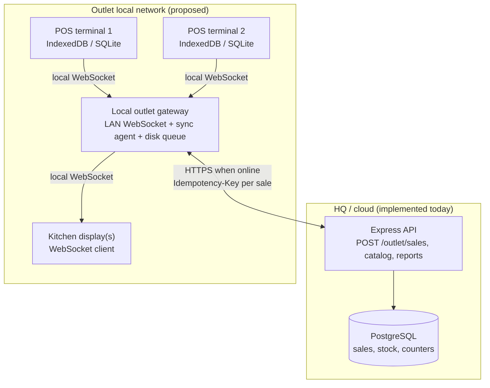
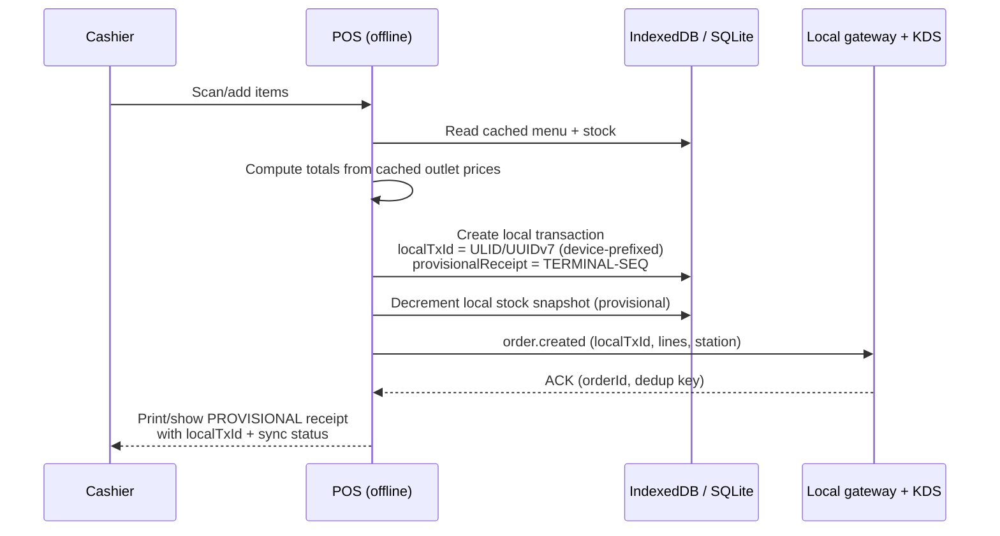
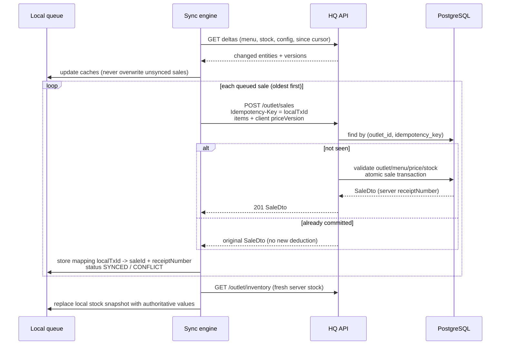
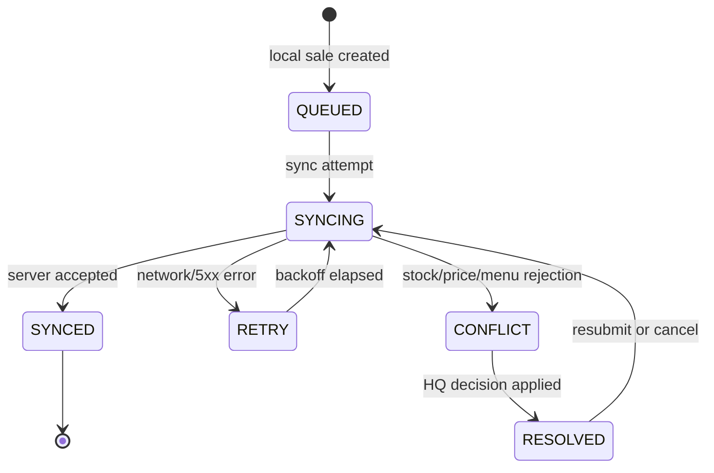
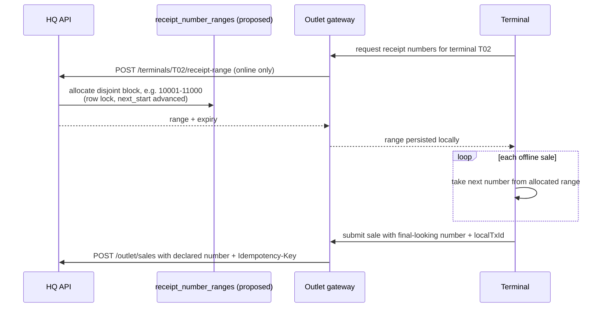
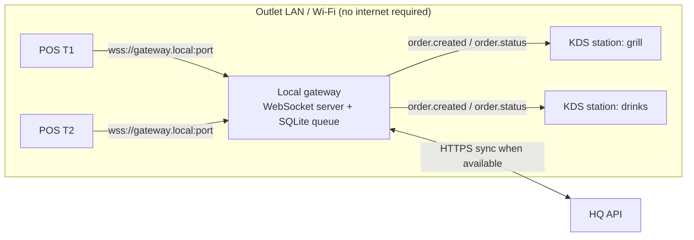
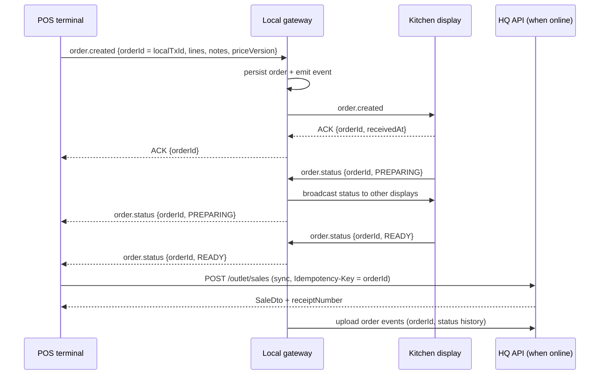

# Offline POS and KDS Strategy

**Status: proposal only.** The current system is online-first and server-authoritative. There is no offline storage, service worker, IndexedDB/SQLite database, pending-transaction queue, kitchen display system (KDS), WebSocket/SSE channel or local gateway in the repository. The web client stores only the JWT in `localStorage` and sends every sale immediately to `POST /api/outlet/sales` with an `Idempotency-Key`. This document describes how offline operation and a local POS↔KDS link could be added **without changing the server's authoritative guarantees**.

## 1. Design principles

1. The central API remains the **system of record**. Offline terminals process sales provisionally and reconcile when connected.
2. Reuse the existing server primitives rather than reinventing them:
   - `POST /api/outlet/sales` with the optional `Idempotency-Key` header (unique per `(outlet_id, idempotency_key)`).
   - Server-side stock validation via guarded atomic decrement; `409 INSUFFICIENT_STOCK`.
   - Per-outlet receipt counters and the unique `(outlet_id, receipt_number)` index.
   - Sale-time price/name/SKU snapshots in `sale_items`.
   - Outlet identity derived from the authenticated user, never from the request.
3. Local state must be **rebuildable** from the server; no local-only business truth survives a device loss.
4. Offline behavior must be visible: cashiers see sync state and provisional receipts; HQ sees which transactions are provisional or rejected.

## 2. Target architecture



**Online mode:** the gateway/terminal calls the API directly; behavior remains essentially today's flow.

**Offline mode:** the gateway keeps serving local menu/stock snapshots, queues sales and order events on disk, and continues POS↔KDS messaging over the LAN. On reconnection it synchronizes with HQ.

## 3. A. Offline POS

### 3.1 Local database options

| Option | Fit | Notes |
| --- | --- | --- |
| IndexedDB (browser PWA) | Best for the current React SPA | Requires a service worker for full offline app shell caching; asynchronous API; quota varies. Use Dexie or a thin wrapper rather than raw IDB. |
| SQLite (local native/kiosk app or gateway) | Best for dedicated terminals and the gateway | Fully offline from day one, transactional, durable; requires packaging a native binary and a local sync process. |

Recommended split: **IndexedDB in the browser** for terminal UI state and pending sales; **SQLite in the outlet gateway** for the shared durable queue, KDS order log and menu cache. A single-terminal outlet may run everything in the browser, but a shared gateway prevents each terminal from maintaining a divergent catalog snapshot.

### 3.2 Local cache contents

| Cache | Contents | Source / freshness |
| --- | --- | --- |
| Menu snapshot | `outlet_menu_items` ID, SKU, name, category, price, availability, master active flag, `menuVersion` | `GET /api/outlet/menu-items`; refresh on connect and on `menuItem.*` / `outletMenu.*` change events |
| Inventory snapshot | Per assignment quantity, threshold, `stockVersion`, snapshot time | `GET /api/outlet/inventory`; provisional decrements applied locally; server value wins after sync |
| Staff/session | Cached `AuthUser`, role, outlet ID, token expiry | `GET /api/auth/me`; offline sessions must be short-lived and revalidated online |
| Receipt configuration | Outlet code, terminal ID, allotted receipt range or provisional prefix | HQ-issued configuration (Section 5) |
| Pending queue | Local sales, KDS order events, stock adjustments | Created locally; never discarded until acknowledged by HQ |
| Sync metadata | Last successful sync cursor, per-record state, conflict details | Maintained by the sync engine |

The snapshot must be **signed or version-stamped** by the API so the server can tell which price version a terminal used. Today the API returns menu DTOs with `updatedAt`; a proposed `menuVersion` (monotonic outlet-level version) would make validation explicit.

### 3.3 Local sale processing



- **Locally generated unique transaction ID:** use a time-sortable ULID/UUIDv7 prefixed with the terminal ID, e.g. `01JQA...-T02`. This is collision-resistant across terminals and outlets, sortable by creation time and independent of a server round trip. Persist it as `externalRef` / client ID on the sale. The current schema has no such column; adding `(outlet_id, external_ref)` as unique is proposed.
- **Pending transaction queue record (proposed):**

```json
{
  "localTxId": "01JQAF2K8T02",
  "outletId": "<uuid from token>",
  "terminalId": "T02",
  "cashierId": "<uuid>",
  "createdAt": "2026-01-05T09:00:00.000Z",
  "items": [{ "outletMenuItemId": "<uuid>", "quantity": 2, "unitPriceCents": 350, "priceVersion": 14 }],
  "totalCents": 700,
  "provisionalReceipt": "T02-0042",
  "status": "QUEUED",
  "attempts": 0,
  "lastError": null
}
```

- The queue is append-only until the server acknowledges the sale; updates use transaction-local writes so a crash cannot leave a half-written sale.

## 4. B. Synchronization

### 4.1 Trigger and flow

Sync starts automatically on `online` events, periodically (for example every 30–60 seconds), after a manual "Sync now" action, and on app start. Only one sync job per outlet may run at a time (a lock in the gateway).



### 4.2 Idempotent submission and duplicate prevention

- Set `Idempotency-Key` to the locally generated `localTxId` (valid characters today: alphanumeric, `.`, `_`, `:`, `-`; 1–100 chars). This directly reuses the implemented unique index `(outlet_id, idempotency_key)`.
- The server's existing service logic returns the original sale for a repeated key and handles concurrent P2002 races by re-reading the committed sale. No new broker-level deduplication is required for sale submission.
- Persist the mapping `localTxId → { serverSaleId, receiptNumber }` locally and, ideally, in a server-side `client_transactions` table with unique `(outlet_id, external_ref)`. That mapping is also used for reprints, refunds and conflict resolution.
- If the response is lost after commit, the retry with the same key returns the committed sale and the client stores the mapping. This is the online equivalent of the current POS retry behavior.

### 4.3 Server-side validation

The API must remain authoritative:

1. Reject items not assigned to the token's outlet or whose master item is inactive (already implemented by `findAssignableByIds`).
2. Re-evaluate availability and compute totals from server prices for the declared `priceVersion`, or accept the client's snapshot only if it is accompanied by a valid signed price token (proposed).
3. Perform the existing guarded stock decrement; return `409 INSUFFICIENT_STOCK` with the failing item.
4. Never trust client-supplied `outletId`, `cashierId`, receipt number, totals or stock quantities.

Proposed new error codes for offline-specific conflicts: `409 PRICE_VERSION_EXPIRED`, `409 STALE_MENU_VERSION`, `422 SALE_REQUIRES_REVIEW`. Existing codes otherwise remain valid.

### 4.4 Conflict resolution policy

| Conflict | Default resolution | Override |
| --- | --- | --- |
| Client price version older than current | If the snapshot is signed and within the configured grace window, honor the old price and record a `PRICE_OVERRIDE` audit row; otherwise reject with `PRICE_VERSION_EXPIRED` | HQ approves/rejects the sale in a review queue |
| Item deactivated while offline | Reject the affected line; whole sale stays `CONFLICT` | HQ may substitute item and reprice with cashier confirmation |
| Stock insufficient on server | Reject the sale; do not create a partial sale | Manager approves substitution or a documented adjustment |
| Client quantity/price/total inconsistent | Reject as invalid; never silently recalculate a customer-facing total | Fix client bug |
| Duplicate localTxId with different payload | Treat as a conflict, not an idempotent replay; alert operations | Manual review; never auto-apply |

### 4.5 Inventory reconciliation

1. Offline stock decrements are **provisional** and only guide the cashier; they never write to HQ.
2. On sync, the server applies its own guarded decrements and returns authoritative stock levels. The client replaces its cached quantities with server values.
3. Movements created by synced sales carry `saleId` and the cashier as actor, exactly as online sales do today; no separate "offline movement" type is needed unless desired for reporting.
4. If local stock reached zero but the server accepted all sales, no adjustment is necessary. If the server rejected a sale for insufficient stock, the local snapshot must be corrected to the server value and the sale moved to a review state.
5. **Prevention:** HQ can allocate per-terminal daily stock quotas or disjoint reserve buffers from the outlet's inventory. This reduces (but does not eliminate) two terminals selling the same last unit.
6. Manual adjustments made offline should be queued as separate operations and applied through the existing `POST /api/outlet/inventory/:outletMenuItemId/stock` and `PATCH /api/outlet/inventory/:outletMenuItemId` endpoints. Those routes do not currently accept an idempotency key; adding one (or deduplicating by a client adjustment ID) is proposed, and offline adjustments require manager approval before sync.

### 4.6 Sync status tracking and retries

Per-record states (proposed):



- UI: persistent indicator showing "Offline — N sales pending", per-sale status icons, last successful sync time, and conflict details with a link to resolution.
- Retry policy: exponential backoff with jitter (e.g., 5 s, 15 s, 1 m, 5 m, 15 m), capped attempts (~10) before moving to `CONFLICT`/dead-letter. Network errors and 5xx are retried; 4xx validation errors are not retried until the conflict is resolved.
- Sync batches should be small (e.g., 20 sales) and ordered by `createdAt` to keep stock reconciliation deterministic.
- A terminal must never delete a queued sale on app uninstall or cache eviction without explicit user confirmation; the gateway's disk queue is the durable backstop.

## 5. C. Receipt numbers

### 5.1 The problem

The current API allocates a single sequential `receipt_number` per outlet from `receipt_counters` with an atomic upsert and a unique `(outlet_id, receipt_number)` index. Offline terminals cannot call that counter, and inventing numbers locally risks collisions when they reconnect.

### 5.2 Local provisional receipt IDs

Every offline sale receives a **provisional** identifier generated locally, for example:

```text
T02-20260105-0042          (terminal ID + date + local sequence)
01JQAF2K8T02-T02           (ULID + terminal ID; also used as idempotency key)
```

Receipts printed offline must be clearly marked **"PROVISIONAL — pending HQ confirmation"** and show the local transaction ID. Once synced, the server returns the final `receiptNumber` and the receipt can be reprinted with it. The local store keeps the mapping so a scan/QR of the provisional ID finds the final sale.

### 5.3 Server-issued receipt ranges (recommended)



- Ranges are **disjoint per terminal within an outlet**, so uniqueness under `(outlet_id, receipt_number)` is preserved without a network call at checkout time.
- Allocation uses a row lock or `UPDATE … RETURNING` against a `receipt_number_ranges` table owned by HQ; unused numbers at range expiry are simply retired (gaps are acceptable).
- The existing `receipt_counters` sequence and unique index remain the final guard: the API must validate a declared number against the terminal's allotted range and, when allocating itself, continue using the atomic counter.
- If a terminal exhausts its range while offline, it must fall back to clearly marked provisional receipts; it must **never** reuse or guess numbers.

### 5.4 Terminal-specific receipt identifiers (alternative)

Use a composite identifier such as `MAIN-T02-0042` with a proposed unique constraint on `(outlet_id, terminal_id, terminal_sequence)`. This avoids central allocation entirely and makes the origin obvious, but changes the current numeric `receiptNumber` contract and customer-facing format. It is a viable alternative when receipts are mostly read within the outlet rather than centrally.

| Aspect | Provisional local ID | Server-issued final number |
| --- | --- | --- |
| Generated by | Terminal (offline) | HQ counter or allotted range |
| Uniqueness scope | Terminal + time (ULID) | Outlet-wide |
| Printed when | Immediately, marked provisional | At sale time (range) or after sync (counter) |
| Stored in | Local queue | `sales.receipt_number` |
| Customer-facing | "Pending confirmation" | Official receipt |
| On reconnect | Mapped to final number; reprint available | Becomes system of record |

## 6. D. Offline POS and KDS communication

### 6.1 Local network architecture



- The gateway runs on a small always-on device in the outlet (mini PC or Raspberry Pi class). It discovers terminals via mDNS/`gateway.local`, hosts a local WebSocket server with WPA2/WPA3 LAN security, and persists events to SQLite so an order is not lost if the KDS is temporarily off.
- Simpler alternative: one POS terminal hosts the WebSocket server and acts as "kitchen leader". This works for a single-terminal outlet but loses orders when that terminal is closed; the dedicated gateway is recommended.
- Station routing can use the existing `menu_items.category` plus a proposed local configuration mapping (`Beverages → drinks`, `Food → grill`). If real kitchen routing is needed, add a `station` field to the master catalog later.

### 6.2 Order lifecycle over the LAN



- Order IDs are the same `localTxId` used for the sale submission. This single identifier links the POS cart, kitchen ticket, sale, receipt and HQ record.
- Status values proposed: `NEW → ACKNOWLEDGED → PREPARING → READY → SERVED`, with `CANCELLED` as a terminal state. The current schema has no order/status table; these live in the gateway's local database and, after sync, in a proposed HQ `kds_orders` / `kds_order_events` pair.
- The KDS must ACK each order; the gateway retries delivery until ACKed and shows undelivered tickets in an alert state.

### 6.3 Duplicate KDS orders and recovery

- Dedupe key: `(orderId, terminalId)` with a unique index in the gateway. Repeated `order.created` messages (POS retry after timeout) return the same ACK and do not create a second ticket.
- Idempotent status updates: include a monotonically increasing `eventSeq` per order; the gateway ignores older or duplicate events and broadcasts only accepted transitions.
- If a KDS was offline when an order was created, the gateway replays the persisted event log on reconnection in `eventSeq` order; the KDS dedupes by `orderId`, so replay cannot duplicate tickets.
- If the gateway fails, POS terminals keep their local queue; a replacement gateway rebuilds local state from HQ plus terminal queues.
- If internet is down for an extended period, kitchen operations continue normally; after reconnection, HQ receives sales and status history with the same IDs and can correlate them without manual matching.
- HQ remains authoritative for sales/financial data; the KDS order log is operational data and may be pruned after a defined retention period.

## 7. E. Conflict scenarios and expected behavior

| Scenario | Immediate local behavior | Server/HQ behavior after reconnect | Resolution / prevention |
| --- | --- | --- | --- |
| **Two terminals sell the last available item** | Both local snapshots show 1 unit; both terminals complete provisionally and decrement their local copies. | First sync succeeds via guarded `UPDATE … WHERE quantity >= q`. Second receives `409 INSUFFICIENT_STOCK` with the item ID. | Second sale enters `CONFLICT`; cashier offers a substitute or cancels with manager approval. Prevent with per-terminal stock quotas/reserve buffers and frequent stock deltas. Never allow negative server stock. |
| **The same transaction syncs twice** | Retry sends the same `localTxId` as `Idempotency-Key`. | Existing `(outlet_id, idempotency_key)` lookup returns the original sale; P2002 race path re-reads it. Stock and receipt counter are untouched. | Client stores local→server ID mapping; duplicate queue entry is acknowledged and removed. |
| **Menu prices change while a terminal is offline** | Terminal uses its cached price and records `priceVersion`. | Server compares version/signed snapshot. Within grace window it may honor the historical price with an audit row; otherwise `409 PRICE_VERSION_EXPIRED`. | HQ review queue approves or rejects. Never silently charge the new price for an already printed offline total. Refresh menu cache on every reconnect. |
| **Internet disconnects during checkout** | If before submission: local sale is queued and marked provisional. If after the request reached the server: the client retries with the same key. | Server either has no record (accepts on retry) or returns the committed sale from idempotency lookup. | Receipt clearly shows provisional status until final `receiptNumber` arrives; customer can reprint the final receipt. |
| **KDS receives duplicate orders** | POS resends `order.created` with the same `orderId` after a timeout; KDS/gateway deduplicates by unique order ID and returns the original ACK. | Uploaded order events dedupe by `orderId` + `eventSeq`; HQ stores one operational order per sale ID. | Dead-letter any status event with an unknown order; alert on duplicate rate above threshold. |
| **Two outlets reconnect after operating offline** | Each outlet syncs independently; keys include the outlet's own IDs and receipt ranges. | Authenticated outlet scoping from `req.auth.outletId` and unique indices scoped by outlet prevent cross-outlet collisions. Master catalog deltas are applied before validating sales. | HQ dashboards update as batches land; investigate outlets whose rejection rate spikes. If a master item was deactivated offline, affected lines go to conflict review. |

Two additional cases worth planning for: a terminal's local cache is lost before sync (recover queued sales from the gateway's disk queue; if none exists, the sale is lost and must be disclosed), and the device clock is wrong (use server time in sync metadata and reject events with implausible timestamps).

## 8. Proposed supporting data model

No migration for these tables exists today; they are listed to make the design actionable.

| Table / store | Key fields | Purpose |
| --- | --- | --- |
| `terminals` | `id`, `outlet_id`, `code`, `name`, `is_active`, `last_seen_at` | Identify terminals and issue per-terminal config |
| `client_transactions` | `outlet_id`, `external_ref`, `sale_id`, `receipt_number`, `received_at` | Durable local→server mapping beyond one device |
| `receipt_number_ranges` | `terminal_id`, `outlet_id`, `start_number`, `end_number`, `next_number`, `expires_at` | Disjoint server-issued blocks |
| `menu_snapshots` | `outlet_id`, `version`, `payload`, `signature`, `created_at` | Signed offline price/menu bundles |
| `kds_orders` | `order_id`, `outlet_id`, `sale_id`, `terminal_id`, `status`, `created_at` | Operational kitchen record after sync |
| `kds_order_events` | `order_id`, `event_seq`, `status`, `occurred_at` | Replayable, idempotent status history |
| local `sync_queue` (IndexedDB/SQLite) | `local_tx_id`, kind, payload, status, attempts, last_error | Durable pending work on the device/gateway |

## 9. Security and operations

- Offline tokens expire; cache the authenticated user only for a bounded period and require online re-authentication beyond it. Never cache passwords.
- Sign menu/price snapshots so a tampered local cache cannot change charged prices; validate price version at sync.
- Authenticate local WebSocket connections with short-lived terminal certificates or tokens issued by the gateway; restrict the gateway to the outlet VLAN where possible.
- Log every provisional sale, conflict and reconciliation decision with terminal ID, local transaction ID and timestamps (server time when available).
- Monitor pending queue depth per terminal, oldest pending age, conflict rate, receipt range utilization, KDS undelivered tickets and sync lag. Alert before ranges are exhausted.

## 10. Suggested delivery phases

1. **Instrument first:** add `externalRef` support to `POST /outlet/sales` and a client-transaction mapping table; test duplicate deliveries thoroughly. No offline UI yet.
2. **Cache:** add a signed menu/inventory snapshot and a visible sync indicator while remaining online-only.
3. **Queue:** add IndexedDB/SQLite pending queue and manual offline checkout with provisional receipts for a pilot terminal.
4. **Sync engine:** automatic retry, conflict states, HQ review screen, inventory reconciliation.
5. **Receipt ranges:** server-issued disjoint blocks and final-receipt reprint flow.
6. **Local gateway + KDS:** WebSocket order distribution, ACKs, status broadcast, replay after outages.
7. **Scale out:** multiple terminals/outlets, monitoring, drills for extended internet outages and disaster recovery.
