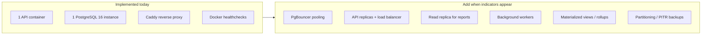
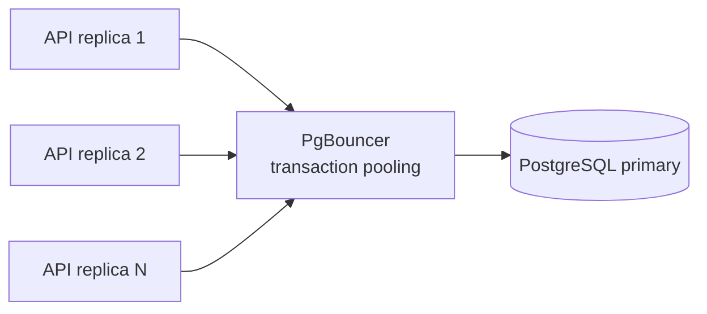
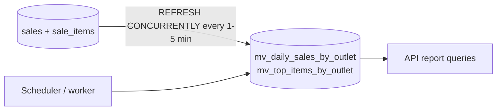
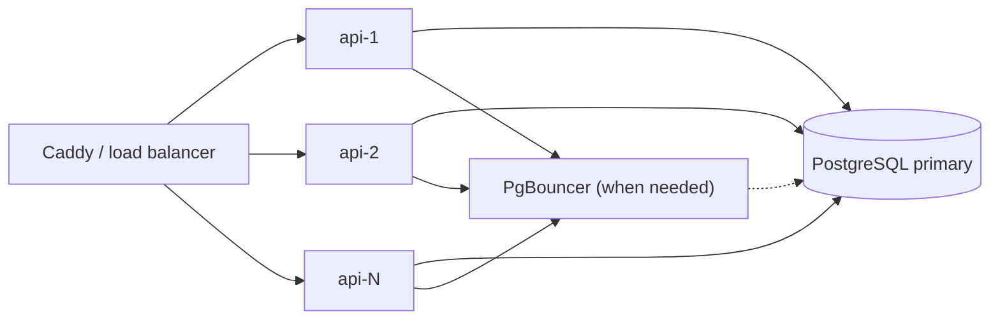

# Scaling Strategy

**Status:** the implemented baseline is described first; all recommendations are labeled **Proposed**. The target workload is **10 outlets and 100,000 completed sales per month**. Nothing in this document makes microservices a prerequisite for the current implementation.

## 1. Workload model

| Metric | Estimate | Interpretation |
| --- | --- | --- |
| Sales per month | 100,000 | Target volume |
| Sales per day | ≈ 3,300 | 100,000 / 30 |
| Sales per hour (12 trading hours) | ≈ 275 | Average across open hours |
| Average write rate | ≈ 0.04 TPS over 24 h; ≈ 0.08 TPS over 12 h | Very low for PostgreSQL |
| Peak write rate (10× average) | ≈ 1 TPS | Easily handled by a single small database |
| Sale items per sale | 1–50 (typically 2–5) | ≈ 300,000–500,000 `sale_items` rows/month |
| Stock movements per sale | One per line | Similar order of magnitude to `sale_items` |

At this scale, correctness, operability and observability dominate over raw throughput. The existing single API + single PostgreSQL design has substantial headroom; most advanced scaling measures are premature until specific thresholds are crossed.

## 2. Implemented baseline

- Single Express API container, stateless request handling: JWT contains only `sub`; all role/outlet state is reloaded from PostgreSQL per request. This makes horizontal replication safe without sticky sessions.
- Single PostgreSQL 16 database with 9 tables, 25 listed indexes, CHECK/FK/unique constraints, and sale-time snapshots.
- Checkout is one `ReadCommitted` transaction with guarded atomic stock updates and an atomic receipt counter upsert. These are the scalability-critical correctness primitives; preserve them in any future design.
- Reports are live parameterized SQL aggregations. Two HQ-reporting indexes (`sales(created_at, outlet_id)` and `sale_items(sale_id, menu_item_sku)`) are already deployed.
- Pagination exists on all list endpoints (default 20, max 100), which bounds response sizes.
- Production Compose provides per-container logging limits, health checks, internal networking, Caddy TLS and a deployment verification script. **Automated database backups, metrics, alerting and multiple API replicas are not implemented.**

## 3. A. Database scaling

### 3.1 Query optimization (start here)

1. Use `EXPLAIN (ANALYZE, BUFFERS)` on the six reporting queries and the paginated sales/inventory queries under representative data volumes (e.g., 1 million sales). Confirm index scans and reasonable row estimates.
2. Keep report predicates sargable: current SQL filters `sales.created_at >= $from AND <= $to` directly on the indexed column, rather than wrapping it in functions.
3. Preserve the existing narrow `SELECT` lists and `COUNT(*)` patterns; avoid adding joins that multiply rows before aggregation.
4. Avoid N+1 access in Prisma by keeping `include` usage in repositories explicit; checkout already batches assignment lookup with a single `IN (...)` query.
5. Keep transactions short: checkout performs only bounded statements (≤ 50 line deductions, two inserts and one movement batch) and no network calls to external systems.
6. Run `ANALYZE` after large data loads and monitor `pg_stat_user_tables` / `pg_stat_user_indexes` for unused indexes and sequential scans.

### 3.2 Connection pooling

Current: each API process uses one PrismaClient, which maintains its own connection pool to PostgreSQL. With one API container this is fine.

**Proposed** when running multiple API instances (or if `pg_stat_activity` approaches `max_connections`):

- Size pools explicitly: `max_connections` on PostgreSQL must exceed PgBouncer's server-side pool plus reserve connections for migrations, backups and admin tooling.
- Use transaction-mode pooling for short API transactions; verify Prisma/PgBouncer compatibility with the deployed client version and avoid server-side prepared statements if the pooler does not support them.
- Run `prisma migrate deploy` through a direct (non-pooled) connection to avoid `CREATE INDEX` / DDL session limitations.
- Set a statement timeout and idle-in-transaction timeout to prevent a stuck checkout from holding stock locks.

Connection pooling is **not necessary** for the target 10-outlet workload with a single API instance; it becomes important when the API is replicated.

### 3.3 Indexing

The current index set is documented in [database-design.md](database-design.md#3-complete-index-inventory). Guidelines:

- Retain the composite indexes that serve scoped history (`sales(outlet_id, created_at)`), HQ date ranges (`sales(created_at, outlet_id)`), assignment lookups, low stock and sale-item joins.
- Add indexes only from observed plans. Candidates, if measurements justify them: a partial index on active outlets/menu items (`WHERE is_active = true`), an index on `stock_movements(sale_id, outlet_menu_item_id)` if sale-level movement reconstruction becomes common, and an expression index if SKU searches become prefix-based.
- Remember that every extra index slows the hot checkout path (`outlet_inventory` updates, `sales` and `sale_items` inserts). Low write volume makes this tolerable, but avoid speculative indexes anyway.
- Monitor index bloat and run `REINDEX CONCURRENTLY` when needed.

### 3.4 Read replicas

**Proposed for later:** route HQ reports and dashboard reads to a hot standby, keeping checkout and inventory writes on the primary.

- Use a separate PrismaClient/datasource for the replica; keep a direct primary client for writes and for reads that require strict read-after-write consistency (receipts immediately after checkout, stock levels on the POS terminal).
- Replication is asynchronous: accept that reports may lag by seconds, and display a "data as of" timestamp if needed.
- Do not send the checkout transaction or idempotency lookups to a replica — stale reads could cause double processing.

At 100,000 sales/month a replica is optional. Add one when reporting queries measurably contend with checkout latency or when a dedicated backup source is required.

### 3.5 Partitioning

**Proposed only when required.** PostgreSQL can handle millions of sales rows in a single unpartitioned table with the current indexes.

Trigger to consider partitioning: `sales` growth beyond roughly 10–50 million rows, sustained vacuum pressure, or a need to drop old data quickly (for example, a 24-month retention policy).

- Use `RANGE` partitioning by `created_at`, typically monthly.
- PostgreSQL requires a unique index (including the primary key) to include the partition key. The existing `UNIQUE (outlet_id, receipt_number)` therefore has to be redesigned for a partitioned table — for example to `(outlet_id, receipt_number, created_at)` — while application logic continues to guarantee uniqueness per outlet. Plan this migration carefully; do not apply it casually.
- `sale_items` and `stock_movements` would need a matching strategy (partition by `sale_id` range or by a duplicated sale timestamp) to keep joins partition-pruned.
- Use detached partitions for cheap archival and retention.

### 3.6 Backup and recovery

Current state: production stores data in the `postgres_data` Docker volume; the README recommends backing up that volume and the `.env` file. There is no scheduled backup or tested restore procedure in the repository.

**Proposed baseline:**

| Layer | Recommendation |
| --- | --- |
| Base backups | Nightly `pg_basebackup` or managed snapshot of the PostgreSQL volume, stored off-host and encrypted |
| Continuous WAL | WAL archiving (for example WAL-G to object storage) for point-in-time recovery (PITR) |
| Logical backups | Periodic `pg_dump` for portable, per-table restores and schema review |
| Retention | 30 daily, 12 monthly copies; immutable/versioned object storage |
| Targets | RPO ≤ 5 minutes with WAL archiving; RTO ≤ 1 hour for full restore on a fresh host |
| Verification | Quarterly restore drill into a scratch environment, then run `prisma migrate status` and smoke tests |
| Secrets | Keep `.env` and `JWT_SECRET` outside backups of the repository; store them in a secret manager or encrypted vault |

## 4. B. Reporting performance

### 4.1 SQL aggregation (implemented)

The six HQ endpoints use parameterized raw SQL: `COUNT(*)` and `SUM(total_cents)` for summaries/revenue, `date_trunc('day', ...)` for daily sales, a `LEFT JOIN` so outlet revenue includes zero-sale outlets, `ROW_NUMBER() OVER (PARTITION BY outletId ...)` for top-five ranking, and a stock/threshold filter for low stock (which has no date range and reads current inventory). This is the correct first approach: it avoids transferring raw rows to the application and produces exact results from immutable sale snapshots.

### 4.2 Materialized views (proposed)

If live aggregation becomes slow:

- Create a unique index on each materialized view's grouping key to allow `REFRESH MATERIALIZED VIEW CONCURRENTLY`.
- Refresh on a schedule (for example, every minute during trading hours) rather than per request. Reports then read a small, pre-aggregated table.
- Consequence: slightly stale HQ reports. Cashier-facing dashboards and receipts must keep reading the primary tables for strict accuracy.
- Not implemented: there are no views, materialized views or refresh jobs in any migration.

### 4.3 Precomputed reporting tables (proposed)

For longer retention or very large history:

- `daily_outlet_sales(outlet_id, day, sales_count, revenue_cents)` — one row per outlet/day, upserted incrementally.
- `daily_outlet_items(outlet_id, day, sku, name, quantity_sold, revenue_cents)` — feed for top-item rankings.
- Backfill once from `sales` / `sale_items`, then update on each completed sale through an outbox event or a scheduled incremental job that processes `created_at > last_processed_at`.
- Keep the raw sale tables as the source of truth; rollups are disposable and rebuildable.

### 4.4 Background reporting jobs (proposed)

- Introduce a worker process that consumes a `sale.completed` event (or polls an outbox table) and updates rollups.
- Make updates idempotent by keying on sale ID: store processed sale IDs or use `INSERT … ON CONFLICT DO UPDATE` with deterministic increments.
- Schedule heavier tasks (daily close, monthly summaries, export generation) outside trading peaks.
- This is a natural first use of background workers without changing the request/response API.

### 4.5 Caching (proposed)

- No application cache exists today; all API responses are deliberately `Cache-Control: no-store`.
- If added, cache only aggregate dashboard/report results with short TTLs (30–120 s) and version keys by report name, outlet, date range and a data-version counter.
- Invalidate or bump the version after checkout and inventory changes for cashier-facing views.
- Never cache receipt or stock responses in a way that can show stale stock to a cashier; the current no-store policy is appropriate for those endpoints.

## 5. C. Infrastructure

### 5.1 Containerized deployment (implemented)

- Multi-stage Dockerfiles: Node 22 Alpine builds `@pos/shared` then the API or web app; runtime images are Node (API) and nginx 1.27 Alpine (web).
- Development Compose publishes PostgreSQL/API/web ports and waits on service health; production Compose is internal-only except for Caddy.
- `VITE_API_URL` is embedded into the SPA at **build time** in the web Dockerfile; it must match the browser-facing API URL.
- Migrations run as a one-shot API command before the application starts; the deploy script verifies both public URLs after rollout.

### 5.2 Horizontal API scaling (proposed)

Because request handling holds no server-side session state (JWT + database reload), multiple identical API containers can run behind a load balancer:

- Run database migrations exactly once per deployment, not from every replica's startup command.
- Avoid in-memory mutable business state; if a local cache is added later, it must be safe to miss on any replica.
- A simple approach is several named Compose services plus a reverse proxy with health-based routing. Kubernetes/Docker Swarm is optional and only worth the operational cost if frequent scaling or self-healing is required.
- A single API replica is **sufficient** for the stated target; scaling is about availability and maintenance windows as much as throughput.

### 5.3 Load balancing

- Today Caddy terminates TLS and reverse-proxies to one `web:80` and one `api:4000` container.
- For replicas, configure an upstream pool with active health checks against `/api/health`; use round-robin or least-connections. No sticky sessions are required.
- Keep the 1 MB JSON body limit in mind when configuring proxy limits, and preserve `CORS_ORIGIN` and security headers.

### 5.4 Monitoring and logging

Implemented: Docker health checks, bounded JSON-file logging in production, health endpoint with database check, and 5xx console logging in the error handler.

Proposed minimum production set:

| Area | Measures |
| --- | --- |
| Metrics | Request rate, error rate by code, p95/p99 latency per endpoint (RED); CPU, memory, event-loop lag (USE); DB connections, lock waits, replication lag |
| Business metrics | Sales/minute, `INSUFFICIENT_STOCK` rate, idempotent replay rate, checkout rollback rate, failed sync batches (if offline support is added) |
| Logs | Structured JSON with timestamp, level, request ID, outlet ID, user ID (never passwords/tokens) and error code; shipped centrally with retention |
| Alerts | Health check failures, 5xx rate > 1%, p95 checkout > 1 s, DB connections > 80% of max, replication lag > 30 s, disk usage > 80% |
| Tracing | Correlation ID propagated from Caddy → API → worker; optional OpenTelemetry when multiple services exist |

There is currently no structured logger, metrics endpoint, APM or alerting system.

### 5.5 Database resource management

- Size `shared_buffers` at roughly 25% of dedicated RAM, set `effective_cache_size` realistically, and tune `work_mem` for report sorts; validate with `EXPLAIN ANALYZE`.
- Enable and tune autovacuum on high-churn tables (`outlet_inventory`, `sales`, `stock_movements`); stock rows are updated on every sale, generating dead tuples.
- Set connection limits explicitly and reserve superuser connections for maintenance.
- Put the data volume on reliable SSD storage with monitoring for IOPS, latency and free space; WAL and data on separate volumes if the host supports it.
- Use read-only users for reporting clients and least-privilege credentials for the API.

## 6. D. Architectural evolution

### 6.1 Evolving the modular monolith

1. **Enforce module boundaries first.** The current layering (`routes → controllers → services → repositories`) already isolates business rules. Make module ownership explicit (identity, catalog, inventory, sales, reporting) so cross-module access goes through service interfaces rather than direct repository calls.
2. **Introduce in-process domain events.** After a sale commits, publish an in-memory `SaleCompleted` event (with the sale ID and outlet ID) for read-model updates. Keep the transactional write path unchanged.
3. **Split read and write models (CQRS-lite).** Reporting services can read rollup tables while checkout continues to write normalized tables. This reduces reporting contention without changing deployment topology.
4. **Extract workers before services.** A worker process sharing the same database can handle rollups, exports, reconciliation and notification delivery. It is the lowest-risk way to introduce asynchronous processing.
5. **Only then consider service extraction**, using the boundaries and events established above. See [microservices-migration.md](microservices-migration.md).

### 6.2 Background workers

- Start with a transactional outbox table written in the sale transaction; a worker polls unpublished rows and processes them idempotently.
- First jobs: update daily rollups, build report snapshots, retry notification delivery, reconcile offline-terminal stock (if offline support is added later).
- Jobs must be retryable, bounded and observable; record attempts and last error.

### 6.3 Asynchronous processing

- Checkout remains synchronous and authoritative: the client receives the committed sale before any downstream side effect.
- Everything that does not affect the customer's receipt (analytics, exports, notifications, reconciliation) moves to asynchronous consumers.
- Use stable event IDs and consumer-side deduplication so at-least-once delivery is safe.

## 7. What is necessary now vs. what can wait

| Measure | At 10 outlets / 100k sales per month | Trigger to adopt |
| --- | --- | --- |
| Existing schema + indexes + transactions | **Sufficient** | — |
| `EXPLAIN ANALYZE` review and `ANALYZE` routine | **Do now** (cheap, prevents regressions) | Any slow report |
| Automated PITR backups + restore drill | **Do now** (operational necessity, not throughput) | Before real production data |
| Basic metrics, structured logs, alerting | **Do now** | Before on-call ownership |
| Caddy TLS, health checks, log rotation | **Implemented** | — |
| Connection pooling (PgBouncer) | Can wait | Multiple API replicas or connection pressure |
| API replicas + load balancer | Can wait | Availability requirement, > ~10 TPS sustained, or maintenance-window pain |
| Read replica | Can wait | Reports measurably hurting checkout latency |
| Materialized views / rollup tables | Can wait | Report p95 above target with optimal indexes |
| Redis/application cache | Can wait | Repeated identical aggregate reads at high rate |
| Background worker + outbox | Optional now; useful first step | Reports/export/notification workload grows |
| Table partitioning | Wait | Tens of millions of sales rows or retention-driven deletes |
| Kubernetes / service mesh | Wait | Many services or strong autoscaling requirements |
| Microservices | **Not required** | Independent team ownership/deploy cadence with proven module boundaries |

**Bottom line:** at the target scale, invest in backups, observability, query verification and disciplined schema changes. Add pooling, replicas, rollups and workers only when measured indicators justify the extra operational surface.
